<a href="https://vishwajit-labs-web.vercel.app/" title="Hi! 👋 Click to visit my portfolio website"></a>

<p align="center">
  <a href="#about-me" title="Jump to About me"></a>
  <a href="#what-i-can-do-for-you" title="Jump to what I can do for you"></a>
  <a href="#experience" title="Jump to my experience"></a>
  <a href="#projects" title="Jump to my projects"></a>
  <a href="#skills" title="Jump to my skills"></a>
  <a href="#contact" title="Jump to contact"></a>
</p>

<p align="center"><b>🐶 <a href="#-meet-byte">Meet Byte, my 3D puppy</a> · spin him, feed him, throw him a ball</b></p>

## 🐶 Meet Byte

<sub><b>Byte is a real 3D puppy.</b> Click and drag him to spin him around, scroll to zoom. Then play with him below.</sub>

```stl
solid byte
facet normal 0 0 -1
outer loop
vertex -12 -6 10
vertex -12 6 10
vertex 12 6 10
endloop
endfacet
facet normal 0 0 -1
outer loop
vertex -12 -6 10
vertex 12 6 10
vertex 12 -6 10
endloop
endfacet
facet normal 0 0 1
outer loop
vertex -12 -6 22
vertex 12 -6 22
vertex 12 6 22
endloop
endfacet
facet normal 0 0 1
outer loop
vertex -12 -6 22
vertex 12 6 22
vertex -12 6 22
endloop
endfacet
facet normal 0 -1 0
outer loop
vertex -12 -6 10
vertex 12 -6 10
vertex 12 -6 22
endloop
endfacet
facet normal 0 -1 0
outer loop
vertex -12 -6 10
vertex 12 -6 22
vertex -12 -6 22
endloop
endfacet
facet normal 0 1 0
outer loop
vertex -12 6 10
vertex -12 6 22
vertex 12 6 22
endloop
endfacet
facet normal 0 1 0
outer loop
vertex -12 6 10
vertex 12 6 22
vertex 12 6 10
endloop
endfacet
facet normal -1 0 0
outer loop
vertex -12 -6 10
vertex -12 -6 22
vertex -12 6 22
endloop
endfacet
facet normal -1 0 0
outer loop
vertex -12 -6 10
vertex -12 6 22
vertex -12 6 10
endloop
endfacet
facet normal 1 0 0
outer loop
vertex 12 -6 10
vertex 12 6 10
vertex 12 6 22
endloop
endfacet
facet normal 1 0 0
outer loop
vertex 12 -6 10
vertex 12 6 22
vertex 12 -6 22
endloop
endfacet
facet normal 0 0 -1
outer loop
vertex -11 -5.5 9
vertex -11 5.5 9
vertex -2 5.5 9
endloop
endfacet
facet normal 0 0 -1
outer loop
vertex -11 -5.5 9
vertex -2 5.5 9
vertex -2 -5.5 9
endloop
endfacet
facet normal 0 0 1
outer loop
vertex -11 -5.5 10.5
vertex -2 -5.5 10.5
vertex -2 5.5 10.5
endloop
endfacet
facet normal 0 0 1
outer loop
vertex -11 -5.5 10.5
vertex -2 5.5 10.5
vertex -11 5.5 10.5
endloop
endfacet
facet normal 0 -1 0
outer loop
vertex -11 -5.5 9
vertex -2 -5.5 9
vertex -2 -5.5 10.5
endloop
endfacet
facet normal 0 -1 0
outer loop
vertex -11 -5.5 9
vertex -2 -5.5 10.5
vertex -11 -5.5 10.5
endloop
endfacet
facet normal 0 1 0
outer loop
vertex -11 5.5 9
vertex -11 5.5 10.5
vertex -2 5.5 10.5
endloop
endfacet
facet normal 0 1 0
outer loop
vertex -11 5.5 9
vertex -2 5.5 10.5
vertex -2 5.5 9
endloop
endfacet
facet normal -1 0 0
outer loop
vertex -11 -5.5 9
vertex -11 -5.5 10.5
vertex -11 5.5 10.5
endloop
endfacet
facet normal -1 0 0
outer loop
vertex -11 -5.5 9
vertex -11 5.5 10.5
vertex -11 5.5 9
endloop
endfacet
facet normal 1 0 0
outer loop
vertex -2 -5.5 9
vertex -2 5.5 9
vertex -2 5.5 10.5
endloop
endfacet
facet normal 1 0 0
outer loop
vertex -2 -5.5 9
vertex -2 5.5 10.5
vertex -2 -5.5 10.5
endloop
endfacet
facet normal 0 0 -1
outer loop
vertex 9 -6.5 17
vertex 9 6.5 17
vertex 12 6.5 17
endloop
endfacet
facet normal 0 0 -1
outer loop
vertex 9 -6.5 17
vertex 12 6.5 17
vertex 12 -6.5 17
endloop
endfacet
facet normal 0 0 1
outer loop
vertex 9 -6.5 22.5
vertex 12 -6.5 22.5
vertex 12 6.5 22.5
endloop
endfacet
facet normal 0 0 1
outer loop
vertex 9 -6.5 22.5
vertex 12 6.5 22.5
vertex 9 6.5 22.5
endloop
endfacet
facet normal 0 -1 0
outer loop
vertex 9 -6.5 17
vertex 12 -6.5 17
vertex 12 -6.5 22.5
endloop
endfacet
facet normal 0 -1 0
outer loop
vertex 9 -6.5 17
vertex 12 -6.5 22.5
vertex 9 -6.5 22.5
endloop
endfacet
facet normal 0 1 0
outer loop
vertex 9 6.5 17
vertex 9 6.5 22.5
vertex 12 6.5 22.5
endloop
endfacet
facet normal 0 1 0
outer loop
vertex 9 6.5 17
vertex 12 6.5 22.5
vertex 12 6.5 17
endloop
endfacet
facet normal -1 0 0
outer loop
vertex 9 -6.5 17
vertex 9 -6.5 22.5
vertex 9 6.5 22.5
endloop
endfacet
facet normal -1 0 0
outer loop
vertex 9 -6.5 17
vertex 9 6.5 22.5
vertex 9 6.5 17
endloop
endfacet
facet normal 1 0 0
outer loop
vertex 12 -6.5 17
vertex 12 6.5 17
vertex 12 6.5 22.5
endloop
endfacet
facet normal 1 0 0
outer loop
vertex 12 -6.5 17
vertex 12 6.5 22.5
vertex 12 -6.5 22.5
endloop
endfacet
facet normal 0 0 -1
outer loop
vertex 10 -6 18
vertex 10 6 18
vertex 22 6 18
endloop
endfacet
facet normal 0 0 -1
outer loop
vertex 10 -6 18
vertex 22 6 18
vertex 22 -6 18
endloop
endfacet
facet normal 0 0 1
outer loop
vertex 10 -6 31
vertex 22 -6 31
vertex 22 6 31
endloop
endfacet
facet normal 0 0 1
outer loop
vertex 10 -6 31
vertex 22 6 31
vertex 10 6 31
endloop
endfacet
facet normal 0 -1 0
outer loop
vertex 10 -6 18
vertex 22 -6 18
vertex 22 -6 31
endloop
endfacet
facet normal 0 -1 0
outer loop
vertex 10 -6 18
vertex 22 -6 31
vertex 10 -6 31
endloop
endfacet
facet normal 0 1 0
outer loop
vertex 10 6 18
vertex 10 6 31
vertex 22 6 31
endloop
endfacet
facet normal 0 1 0
outer loop
vertex 10 6 18
vertex 22 6 31
vertex 22 6 18
endloop
endfacet
facet normal -1 0 0
outer loop
vertex 10 -6 18
vertex 10 -6 31
vertex 10 6 31
endloop
endfacet
facet normal -1 0 0
outer loop
vertex 10 -6 18
vertex 10 6 31
vertex 10 6 18
endloop
endfacet
facet normal 1 0 0
outer loop
vertex 22 -6 18
vertex 22 6 18
vertex 22 6 31
endloop
endfacet
facet normal 1 0 0
outer loop
vertex 22 -6 18
vertex 22 6 31
vertex 22 -6 31
endloop
endfacet
facet normal 0 0 -1
outer loop
vertex 22 -3.6 19
vertex 22 3.6 19
vertex 29 3.6 19
endloop
endfacet
facet normal 0 0 -1
outer loop
vertex 22 -3.6 19
vertex 29 3.6 19
vertex 29 -3.6 19
endloop
endfacet
facet normal 0 0 1
outer loop
vertex 22 -3.6 25
vertex 29 -3.6 25
vertex 29 3.6 25
endloop
endfacet
facet normal 0 0 1
outer loop
vertex 22 -3.6 25
vertex 29 3.6 25
vertex 22 3.6 25
endloop
endfacet
facet normal 0 -1 0
outer loop
vertex 22 -3.6 19
vertex 29 -3.6 19
vertex 29 -3.6 25
endloop
endfacet
facet normal 0 -1 0
outer loop
vertex 22 -3.6 19
vertex 29 -3.6 25
vertex 22 -3.6 25
endloop
endfacet
facet normal 0 1 0
outer loop
vertex 22 3.6 19
vertex 22 3.6 25
vertex 29 3.6 25
endloop
endfacet
facet normal 0 1 0
outer loop
vertex 22 3.6 19
vertex 29 3.6 25
vertex 29 3.6 19
endloop
endfacet
facet normal -1 0 0
outer loop
vertex 22 -3.6 19
vertex 22 -3.6 25
vertex 22 3.6 25
endloop
endfacet
facet normal -1 0 0
outer loop
vertex 22 -3.6 19
vertex 22 3.6 25
vertex 22 3.6 19
endloop
endfacet
facet normal 1 0 0
outer loop
vertex 29 -3.6 19
vertex 29 3.6 19
vertex 29 3.6 25
endloop
endfacet
facet normal 1 0 0
outer loop
vertex 29 -3.6 19
vertex 29 3.6 25
vertex 29 -3.6 25
endloop
endfacet
facet normal 0 0 -1
outer loop
vertex 29 -1.6 22.2
vertex 29 1.6 22.2
vertex 30.6 1.6 22.2
endloop
endfacet
facet normal 0 0 -1
outer loop
vertex 29 -1.6 22.2
vertex 30.6 1.6 22.2
vertex 30.6 -1.6 22.2
endloop
endfacet
facet normal 0 0 1
outer loop
vertex 29 -1.6 25.2
vertex 30.6 -1.6 25.2
vertex 30.6 1.6 25.2
endloop
endfacet
facet normal 0 0 1
outer loop
vertex 29 -1.6 25.2
vertex 30.6 1.6 25.2
vertex 29 1.6 25.2
endloop
endfacet
facet normal 0 -1 0
outer loop
vertex 29 -1.6 22.2
vertex 30.6 -1.6 22.2
vertex 30.6 -1.6 25.2
endloop
endfacet
facet normal 0 -1 0
outer loop
vertex 29 -1.6 22.2
vertex 30.6 -1.6 25.2
vertex 29 -1.6 25.2
endloop
endfacet
facet normal 0 1 0
outer loop
vertex 29 1.6 22.2
vertex 29 1.6 25.2
vertex 30.6 1.6 25.2
endloop
endfacet
facet normal 0 1 0
outer loop
vertex 29 1.6 22.2
vertex 30.6 1.6 25.2
vertex 30.6 1.6 22.2
endloop
endfacet
facet normal -1 0 0
outer loop
vertex 29 -1.6 22.2
vertex 29 -1.6 25.2
vertex 29 1.6 25.2
endloop
endfacet
facet normal -1 0 0
outer loop
vertex 29 -1.6 22.2
vertex 29 1.6 25.2
vertex 29 1.6 22.2
endloop
endfacet
facet normal 1 0 0
outer loop
vertex 30.6 -1.6 22.2
vertex 30.6 1.6 22.2
vertex 30.6 1.6 25.2
endloop
endfacet
facet normal 1 0 0
outer loop
vertex 30.6 -1.6 22.2
vertex 30.6 1.6 25.2
vertex 30.6 -1.6 25.2
endloop
endfacet
facet normal 0 0 -1
outer loop
vertex 22 1.8 26
vertex 22 4.2 26
vertex 22.9 4.2 26
endloop
endfacet
facet normal 0 0 -1
outer loop
vertex 22 1.8 26
vertex 22.9 4.2 26
vertex 22.9 1.8 26
endloop
endfacet
facet normal 0 0 1
outer loop
vertex 22 1.8 28.4
vertex 22.9 1.8 28.4
vertex 22.9 4.2 28.4
endloop
endfacet
facet normal 0 0 1
outer loop
vertex 22 1.8 28.4
vertex 22.9 4.2 28.4
vertex 22 4.2 28.4
endloop
endfacet
facet normal 0 -1 0
outer loop
vertex 22 1.8 26
vertex 22.9 1.8 26
vertex 22.9 1.8 28.4
endloop
endfacet
facet normal 0 -1 0
outer loop
vertex 22 1.8 26
vertex 22.9 1.8 28.4
vertex 22 1.8 28.4
endloop
endfacet
facet normal 0 1 0
outer loop
vertex 22 4.2 26
vertex 22 4.2 28.4
vertex 22.9 4.2 28.4
endloop
endfacet
facet normal 0 1 0
outer loop
vertex 22 4.2 26
vertex 22.9 4.2 28.4
vertex 22.9 4.2 26
endloop
endfacet
facet normal -1 0 0
outer loop
vertex 22 1.8 26
vertex 22 1.8 28.4
vertex 22 4.2 28.4
endloop
endfacet
facet normal -1 0 0
outer loop
vertex 22 1.8 26
vertex 22 4.2 28.4
vertex 22 4.2 26
endloop
endfacet
facet normal 1 0 0
outer loop
vertex 22.9 1.8 26
vertex 22.9 4.2 26
vertex 22.9 4.2 28.4
endloop
endfacet
facet normal 1 0 0
outer loop
vertex 22.9 1.8 26
vertex 22.9 4.2 28.4
vertex 22.9 1.8 28.4
endloop
endfacet
facet normal 0 0 -1
outer loop
vertex 22 -4.2 26
vertex 22 -1.8 26
vertex 22.9 -1.8 26
endloop
endfacet
facet normal 0 0 -1
outer loop
vertex 22 -4.2 26
vertex 22.9 -1.8 26
vertex 22.9 -4.2 26
endloop
endfacet
facet normal 0 0 1
outer loop
vertex 22 -4.2 28.4
vertex 22.9 -4.2 28.4
vertex 22.9 -1.8 28.4
endloop
endfacet
facet normal 0 0 1
outer loop
vertex 22 -4.2 28.4
vertex 22.9 -1.8 28.4
vertex 22 -1.8 28.4
endloop
endfacet
facet normal 0 -1 0
outer loop
vertex 22 -4.2 26
vertex 22.9 -4.2 26
vertex 22.9 -4.2 28.4
endloop
endfacet
facet normal 0 -1 0
outer loop
vertex 22 -4.2 26
vertex 22.9 -4.2 28.4
vertex 22 -4.2 28.4
endloop
endfacet
facet normal 0 1 0
outer loop
vertex 22 -1.8 26
vertex 22 -1.8 28.4
vertex 22.9 -1.8 28.4
endloop
endfacet
facet normal 0 1 0
outer loop
vertex 22 -1.8 26
vertex 22.9 -1.8 28.4
vertex 22.9 -1.8 26
endloop
endfacet
facet normal -1 0 0
outer loop
vertex 22 -4.2 26
vertex 22 -4.2 28.4
vertex 22 -1.8 28.4
endloop
endfacet
facet normal -1 0 0
outer loop
vertex 22 -4.2 26
vertex 22 -1.8 28.4
vertex 22 -1.8 26
endloop
endfacet
facet normal 1 0 0
outer loop
vertex 22.9 -4.2 26
vertex 22.9 -1.8 26
vertex 22.9 -1.8 28.4
endloop
endfacet
facet normal 1 0 0
outer loop
vertex 22.9 -4.2 26
vertex 22.9 -1.8 28.4
vertex 22.9 -4.2 28.4
endloop
endfacet
facet normal 0 0 -1
outer loop
vertex 11.5 6 17
vertex 11.5 8.2 17
vertex 16.5 8.2 17
endloop
endfacet
facet normal 0 0 -1
outer loop
vertex 11.5 6 17
vertex 16.5 8.2 17
vertex 16.5 6 17
endloop
endfacet
facet normal 0 0 1
outer loop
vertex 11.5 6 30
vertex 16.5 6 30
vertex 16.5 8.2 30
endloop
endfacet
facet normal 0 0 1
outer loop
vertex 11.5 6 30
vertex 16.5 8.2 30
vertex 11.5 8.2 30
endloop
endfacet
facet normal 0 -1 0
outer loop
vertex 11.5 6 17
vertex 16.5 6 17
vertex 16.5 6 30
endloop
endfacet
facet normal 0 -1 0
outer loop
vertex 11.5 6 17
vertex 16.5 6 30
vertex 11.5 6 30
endloop
endfacet
facet normal 0 1 0
outer loop
vertex 11.5 8.2 17
vertex 11.5 8.2 30
vertex 16.5 8.2 30
endloop
endfacet
facet normal 0 1 0
outer loop
vertex 11.5 8.2 17
vertex 16.5 8.2 30
vertex 16.5 8.2 17
endloop
endfacet
facet normal -1 0 0
outer loop
vertex 11.5 6 17
vertex 11.5 6 30
vertex 11.5 8.2 30
endloop
endfacet
facet normal -1 0 0
outer loop
vertex 11.5 6 17
vertex 11.5 8.2 30
vertex 11.5 8.2 17
endloop
endfacet
facet normal 1 0 0
outer loop
vertex 16.5 6 17
vertex 16.5 8.2 17
vertex 16.5 8.2 30
endloop
endfacet
facet normal 1 0 0
outer loop
vertex 16.5 6 17
vertex 16.5 8.2 30
vertex 16.5 6 30
endloop
endfacet
facet normal 0 0 -1
outer loop
vertex 11.5 -8.2 17
vertex 11.5 -6 17
vertex 16.5 -6 17
endloop
endfacet
facet normal 0 0 -1
outer loop
vertex 11.5 -8.2 17
vertex 16.5 -6 17
vertex 16.5 -8.2 17
endloop
endfacet
facet normal 0 0 1
outer loop
vertex 11.5 -8.2 30
vertex 16.5 -8.2 30
vertex 16.5 -6 30
endloop
endfacet
facet normal 0 0 1
outer loop
vertex 11.5 -8.2 30
vertex 16.5 -6 30
vertex 11.5 -6 30
endloop
endfacet
facet normal 0 -1 0
outer loop
vertex 11.5 -8.2 17
vertex 16.5 -8.2 17
vertex 16.5 -8.2 30
endloop
endfacet
facet normal 0 -1 0
outer loop
vertex 11.5 -8.2 17
vertex 16.5 -8.2 30
vertex 11.5 -8.2 30
endloop
endfacet
facet normal 0 1 0
outer loop
vertex 11.5 -6 17
vertex 11.5 -6 30
vertex 16.5 -6 30
endloop
endfacet
facet normal 0 1 0
outer loop
vertex 11.5 -6 17
vertex 16.5 -6 30
vertex 16.5 -6 17
endloop
endfacet
facet normal -1 0 0
outer loop
vertex 11.5 -8.2 17
vertex 11.5 -8.2 30
vertex 11.5 -6 30
endloop
endfacet
facet normal -1 0 0
outer loop
vertex 11.5 -8.2 17
vertex 11.5 -6 30
vertex 11.5 -6 17
endloop
endfacet
facet normal 1 0 0
outer loop
vertex 16.5 -8.2 17
vertex 16.5 -6 17
vertex 16.5 -6 30
endloop
endfacet
facet normal 1 0 0
outer loop
vertex 16.5 -8.2 17
vertex 16.5 -6 30
vertex 16.5 -8.2 30
endloop
endfacet
facet normal 0 0 -1
outer loop
vertex 24 -1.5 16.5
vertex 24 1.5 16.5
vertex 27 1.5 16.5
endloop
endfacet
facet normal 0 0 -1
outer loop
vertex 24 -1.5 16.5
vertex 27 1.5 16.5
vertex 27 -1.5 16.5
endloop
endfacet
facet normal 0 0 1
outer loop
vertex 24 -1.5 19
vertex 27 -1.5 19
vertex 27 1.5 19
endloop
endfacet
facet normal 0 0 1
outer loop
vertex 24 -1.5 19
vertex 27 1.5 19
vertex 24 1.5 19
endloop
endfacet
facet normal 0 -1 0
outer loop
vertex 24 -1.5 16.5
vertex 27 -1.5 16.5
vertex 27 -1.5 19
endloop
endfacet
facet normal 0 -1 0
outer loop
vertex 24 -1.5 16.5
vertex 27 -1.5 19
vertex 24 -1.5 19
endloop
endfacet
facet normal 0 1 0
outer loop
vertex 24 1.5 16.5
vertex 24 1.5 19
vertex 27 1.5 19
endloop
endfacet
facet normal 0 1 0
outer loop
vertex 24 1.5 16.5
vertex 27 1.5 19
vertex 27 1.5 16.5
endloop
endfacet
facet normal -1 0 0
outer loop
vertex 24 -1.5 16.5
vertex 24 -1.5 19
vertex 24 1.5 19
endloop
endfacet
facet normal -1 0 0
outer loop
vertex 24 -1.5 16.5
vertex 24 1.5 19
vertex 24 1.5 16.5
endloop
endfacet
facet normal 1 0 0
outer loop
vertex 27 -1.5 16.5
vertex 27 1.5 16.5
vertex 27 1.5 19
endloop
endfacet
facet normal 1 0 0
outer loop
vertex 27 -1.5 16.5
vertex 27 1.5 19
vertex 27 -1.5 19
endloop
endfacet
facet normal 0 0 -1
outer loop
vertex -10.5 1.5 0
vertex -10.5 5.5 0
vertex -5.5 5.5 0
endloop
endfacet
facet normal 0 0 -1
outer loop
vertex -10.5 1.5 0
vertex -5.5 5.5 0
vertex -5.5 1.5 0
endloop
endfacet
facet normal 0 0 1
outer loop
vertex -10.5 1.5 10
vertex -5.5 1.5 10
vertex -5.5 5.5 10
endloop
endfacet
facet normal 0 0 1
outer loop
vertex -10.5 1.5 10
vertex -5.5 5.5 10
vertex -10.5 5.5 10
endloop
endfacet
facet normal 0 -1 0
outer loop
vertex -10.5 1.5 0
vertex -5.5 1.5 0
vertex -5.5 1.5 10
endloop
endfacet
facet normal 0 -1 0
outer loop
vertex -10.5 1.5 0
vertex -5.5 1.5 10
vertex -10.5 1.5 10
endloop
endfacet
facet normal 0 1 0
outer loop
vertex -10.5 5.5 0
vertex -10.5 5.5 10
vertex -5.5 5.5 10
endloop
endfacet
facet normal 0 1 0
outer loop
vertex -10.5 5.5 0
vertex -5.5 5.5 10
vertex -5.5 5.5 0
endloop
endfacet
facet normal -1 0 0
outer loop
vertex -10.5 1.5 0
vertex -10.5 1.5 10
vertex -10.5 5.5 10
endloop
endfacet
facet normal -1 0 0
outer loop
vertex -10.5 1.5 0
vertex -10.5 5.5 10
vertex -10.5 5.5 0
endloop
endfacet
facet normal 1 0 0
outer loop
vertex -5.5 1.5 0
vertex -5.5 5.5 0
vertex -5.5 5.5 10
endloop
endfacet
facet normal 1 0 0
outer loop
vertex -5.5 1.5 0
vertex -5.5 5.5 10
vertex -5.5 1.5 10
endloop
endfacet
facet normal 0 0 -1
outer loop
vertex -10.5 -5.5 0
vertex -10.5 -1.5 0
vertex -5.5 -1.5 0
endloop
endfacet
facet normal 0 0 -1
outer loop
vertex -10.5 -5.5 0
vertex -5.5 -1.5 0
vertex -5.5 -5.5 0
endloop
endfacet
facet normal 0 0 1
outer loop
vertex -10.5 -5.5 10
vertex -5.5 -5.5 10
vertex -5.5 -1.5 10
endloop
endfacet
facet normal 0 0 1
outer loop
vertex -10.5 -5.5 10
vertex -5.5 -1.5 10
vertex -10.5 -1.5 10
endloop
endfacet
facet normal 0 -1 0
outer loop
vertex -10.5 -5.5 0
vertex -5.5 -5.5 0
vertex -5.5 -5.5 10
endloop
endfacet
facet normal 0 -1 0
outer loop
vertex -10.5 -5.5 0
vertex -5.5 -5.5 10
vertex -10.5 -5.5 10
endloop
endfacet
facet normal 0 1 0
outer loop
vertex -10.5 -1.5 0
vertex -10.5 -1.5 10
vertex -5.5 -1.5 10
endloop
endfacet
facet normal 0 1 0
outer loop
vertex -10.5 -1.5 0
vertex -5.5 -1.5 10
vertex -5.5 -1.5 0
endloop
endfacet
facet normal -1 0 0
outer loop
vertex -10.5 -5.5 0
vertex -10.5 -5.5 10
vertex -10.5 -1.5 10
endloop
endfacet
facet normal -1 0 0
outer loop
vertex -10.5 -5.5 0
vertex -10.5 -1.5 10
vertex -10.5 -1.5 0
endloop
endfacet
facet normal 1 0 0
outer loop
vertex -5.5 -5.5 0
vertex -5.5 -1.5 0
vertex -5.5 -1.5 10
endloop
endfacet
facet normal 1 0 0
outer loop
vertex -5.5 -5.5 0
vertex -5.5 -1.5 10
vertex -5.5 -5.5 10
endloop
endfacet
facet normal 0 0 -1
outer loop
vertex 5 1.5 0
vertex 5 5.5 0
vertex 10 5.5 0
endloop
endfacet
facet normal 0 0 -1
outer loop
vertex 5 1.5 0
vertex 10 5.5 0
vertex 10 1.5 0
endloop
endfacet
facet normal 0 0 1
outer loop
vertex 5 1.5 10
vertex 10 1.5 10
vertex 10 5.5 10
endloop
endfacet
facet normal 0 0 1
outer loop
vertex 5 1.5 10
vertex 10 5.5 10
vertex 5 5.5 10
endloop
endfacet
facet normal 0 -1 0
outer loop
vertex 5 1.5 0
vertex 10 1.5 0
vertex 10 1.5 10
endloop
endfacet
facet normal 0 -1 0
outer loop
vertex 5 1.5 0
vertex 10 1.5 10
vertex 5 1.5 10
endloop
endfacet
facet normal 0 1 0
outer loop
vertex 5 5.5 0
vertex 5 5.5 10
vertex 10 5.5 10
endloop
endfacet
facet normal 0 1 0
outer loop
vertex 5 5.5 0
vertex 10 5.5 10
vertex 10 5.5 0
endloop
endfacet
facet normal -1 0 0
outer loop
vertex 5 1.5 0
vertex 5 1.5 10
vertex 5 5.5 10
endloop
endfacet
facet normal -1 0 0
outer loop
vertex 5 1.5 0
vertex 5 5.5 10
vertex 5 5.5 0
endloop
endfacet
facet normal 1 0 0
outer loop
vertex 10 1.5 0
vertex 10 5.5 0
vertex 10 5.5 10
endloop
endfacet
facet normal 1 0 0
outer loop
vertex 10 1.5 0
vertex 10 5.5 10
vertex 10 1.5 10
endloop
endfacet
facet normal 0 0 -1
outer loop
vertex 5 -5.5 0
vertex 5 -1.5 0
vertex 10 -1.5 0
endloop
endfacet
facet normal 0 0 -1
outer loop
vertex 5 -5.5 0
vertex 10 -1.5 0
vertex 10 -5.5 0
endloop
endfacet
facet normal 0 0 1
outer loop
vertex 5 -5.5 10
vertex 10 -5.5 10
vertex 10 -1.5 10
endloop
endfacet
facet normal 0 0 1
outer loop
vertex 5 -5.5 10
vertex 10 -1.5 10
vertex 5 -1.5 10
endloop
endfacet
facet normal 0 -1 0
outer loop
vertex 5 -5.5 0
vertex 10 -5.5 0
vertex 10 -5.5 10
endloop
endfacet
facet normal 0 -1 0
outer loop
vertex 5 -5.5 0
vertex 10 -5.5 10
vertex 5 -5.5 10
endloop
endfacet
facet normal 0 1 0
outer loop
vertex 5 -1.5 0
vertex 5 -1.5 10
vertex 10 -1.5 10
endloop
endfacet
facet normal 0 1 0
outer loop
vertex 5 -1.5 0
vertex 10 -1.5 10
vertex 10 -1.5 0
endloop
endfacet
facet normal -1 0 0
outer loop
vertex 5 -5.5 0
vertex 5 -5.5 10
vertex 5 -1.5 10
endloop
endfacet
facet normal -1 0 0
outer loop
vertex 5 -5.5 0
vertex 5 -1.5 10
vertex 5 -1.5 0
endloop
endfacet
facet normal 1 0 0
outer loop
vertex 10 -5.5 0
vertex 10 -1.5 0
vertex 10 -1.5 10
endloop
endfacet
facet normal 1 0 0
outer loop
vertex 10 -5.5 0
vertex 10 -1.5 10
vertex 10 -5.5 10
endloop
endfacet
facet normal 0 0 -1
outer loop
vertex -18 -1.5 19
vertex -18 1.5 19
vertex -12 1.5 19
endloop
endfacet
facet normal 0 0 -1
outer loop
vertex -18 -1.5 19
vertex -12 1.5 19
vertex -12 -1.5 19
endloop
endfacet
facet normal 0 0 1
outer loop
vertex -18 -1.5 22
vertex -12 -1.5 22
vertex -12 1.5 22
endloop
endfacet
facet normal 0 0 1
outer loop
vertex -18 -1.5 22
vertex -12 1.5 22
vertex -18 1.5 22
endloop
endfacet
facet normal 0 -1 0
outer loop
vertex -18 -1.5 19
vertex -12 -1.5 19
vertex -12 -1.5 22
endloop
endfacet
facet normal 0 -1 0
outer loop
vertex -18 -1.5 19
vertex -12 -1.5 22
vertex -18 -1.5 22
endloop
endfacet
facet normal 0 1 0
outer loop
vertex -18 1.5 19
vertex -18 1.5 22
vertex -12 1.5 22
endloop
endfacet
facet normal 0 1 0
outer loop
vertex -18 1.5 19
vertex -12 1.5 22
vertex -12 1.5 19
endloop
endfacet
facet normal -1 0 0
outer loop
vertex -18 -1.5 19
vertex -18 -1.5 22
vertex -18 1.5 22
endloop
endfacet
facet normal -1 0 0
outer loop
vertex -18 -1.5 19
vertex -18 1.5 22
vertex -18 1.5 19
endloop
endfacet
facet normal 1 0 0
outer loop
vertex -12 -1.5 19
vertex -12 1.5 19
vertex -12 1.5 22
endloop
endfacet
facet normal 1 0 0
outer loop
vertex -12 -1.5 19
vertex -12 1.5 22
vertex -12 -1.5 22
endloop
endfacet
facet normal 0 0 -1
outer loop
vertex -21 -1.5 21
vertex -21 1.5 21
vertex -17 1.5 21
endloop
endfacet
facet normal 0 0 -1
outer loop
vertex -21 -1.5 21
vertex -17 1.5 21
vertex -17 -1.5 21
endloop
endfacet
facet normal 0 0 1
outer loop
vertex -21 -1.5 29
vertex -17 -1.5 29
vertex -17 1.5 29
endloop
endfacet
facet normal 0 0 1
outer loop
vertex -21 -1.5 29
vertex -17 1.5 29
vertex -21 1.5 29
endloop
endfacet
facet normal 0 -1 0
outer loop
vertex -21 -1.5 21
vertex -17 -1.5 21
vertex -17 -1.5 29
endloop
endfacet
facet normal 0 -1 0
outer loop
vertex -21 -1.5 21
vertex -17 -1.5 29
vertex -21 -1.5 29
endloop
endfacet
facet normal 0 1 0
outer loop
vertex -21 1.5 21
vertex -21 1.5 29
vertex -17 1.5 29
endloop
endfacet
facet normal 0 1 0
outer loop
vertex -21 1.5 21
vertex -17 1.5 29
vertex -17 1.5 21
endloop
endfacet
facet normal -1 0 0
outer loop
vertex -21 -1.5 21
vertex -21 -1.5 29
vertex -21 1.5 29
endloop
endfacet
facet normal -1 0 0
outer loop
vertex -21 -1.5 21
vertex -21 1.5 29
vertex -21 1.5 21
endloop
endfacet
facet normal 1 0 0
outer loop
vertex -17 -1.5 21
vertex -17 1.5 21
vertex -17 1.5 29
endloop
endfacet
facet normal 1 0 0
outer loop
vertex -17 -1.5 21
vertex -17 1.5 29
vertex -17 -1.5 29
endloop
endfacet
endsolid byte
```

<details>
<summary><b>🦴 Give Byte a treat</b></summary>

> 🐶💨 *Byte zooms over…* **CHOMP!** 🦴 → 😋
> "Thank you! 💖" He does a happy little spin. 🌀

<details>
<summary>🦴 Give him another one</summary>

> 🐶 Byte looks at the treat… then at you… 🤔
> He buries it under the **[Skills](#skills)** section for later. 🕳️🦴
> *A planner. Just like his human, who plans before he builds.*

</details>
<details>
<summary>🛑 That's enough treats, Byte</summary>

> 🥺 *Puppy eyes: activated.* Byte respects your decision. Mostly.

</details>
</details>

<details>
<summary><b>🎾 Throw the ball</b></summary>

> 🎾 ➡️ ➡️ ➡️ 🐕💨 **Got it!**
> Byte runs back and drops it at your feet. "Again! Again!" 🐾

<details>
<summary>🎾 Throw it really, really far</summary>

> 🎾✈️ … it lands somewhere in **[Projects](#projects)**.
> Byte comes back carrying **DevFlow-AI** instead. "Look what I found! 🤖"

</details>
</details>

<details>
<summary><b>✋ Pet Byte</b></summary>

> 🐶 → 🥰 Byte rolls over for belly rubs.
> ❤️❤️❤️ *Friendship level: MAX*

<details>
<summary>🐾 Ask Byte to shake hands</summary>

> 🐾🤝 Byte offers his paw. "Nice to meet you! Now go say hi to my human → **[Contact](#contact)**"

</details>
</details>

<details>
<summary><b>🗣️ Ask Byte about his human</b></summary>

> 🐶 "Woof! He builds the engines behind apps — servers, databases, APIs — and teaches them to think with AI.
> 5+ years, 24 projects, one Outstanding Performance Award… and one very good boy. (That's me.)"

</details>

## About me

<a href="mailto:vishwajitmall50@gmail.com" title="Click to send me an email ✉️"></a>

## Find me online

<p align="center">
  <a href="mailto:vishwajitmall50@gmail.com" title="Email me at vishwajitmall50@gmail.com"></a>
  <a href="https://www.linkedin.com/in/vishwajit-vm-179a61149" title="Connect with me on LinkedIn"></a>
  <a href="https://github.com/vishwajitvm" title="Follow me on GitHub"></a>
  <a href="https://vishwajit-labs-web.vercel.app/" title="Visit my portfolio, Vishwajit Labs"></a>
  <a href="https://www.twitter.com/VishwajitVm" title="Follow me on X (Twitter)"></a>
</p>
<p align="center">
  <a href="https://hashnode.com/@Vishwajitvm" title="Read my blog on Hashnode"></a>
  <a href="https://www.youtube.com/channel/UCldd1WpTGf1uX1ZDdNH20IA" title="Subscribe on YouTube"></a>
  <a href="https://www.codepen.io/vishwajitvm" title="See my pens on CodePen"></a>
  <a href="https://pypi.org/user/vishwajitvm/" title="See my Python packages on PyPI"></a>
  <a href="https://www.buymeacoffee.com/vishwajitm7" title="Buy me a coffee ☕"></a>
</p>

## What I can do for you


## Experience



<sub>🗺️ <b>Where I've worked, on a live map.</b> Drag to move, scroll to zoom, click a pin for the role and dates.</sub>

```geojson
{
 "type": "FeatureCollection",
 "features": [
  {
   "type": "Feature",
   "geometry": {
    "type": "Point",
    "coordinates": [
     77.391,
     28.5355
    ]
   },
   "properties": {
    "title": "SPNX (now)",
    "role": "Backend Developer · FLO, an EU VAT platform",
    "dates": "Oct 2026 – now",
    "marker-color": "#7C3AED",
    "marker-symbol": "star",
    "marker-size": "large"
   }
  },
  {
   "type": "Feature",
   "geometry": {
    "type": "Point",
    "coordinates": [
     73.8567,
     18.5204
    ]
   },
   "properties": {
    "title": "Bee Logical Software Solutions",
    "role": "Full Stack Developer · 🏆 Outstanding Performance Award 2024",
    "dates": "Nov 2022 – Jun 2026",
    "marker-color": "#059669",
    "marker-symbol": "building",
    "marker-size": "medium"
   }
  },
  {
   "type": "Feature",
   "geometry": {
    "type": "Point",
    "coordinates": [
     77.209,
     28.6139
    ]
   },
   "properties": {
    "title": "WebReinvent",
    "role": "Software Developer · VaahCMS",
    "dates": "Jul – Oct 2022",
    "marker-color": "#0284C7",
    "marker-symbol": "building",
    "marker-size": "medium"
   }
  },
  {
   "type": "Feature",
   "geometry": {
    "type": "Point",
    "coordinates": [
     77.1,
     28.65
    ]
   },
   "properties": {
    "title": "BluBrandz Technologies",
    "role": "Full Stack Developer · my first role",
    "dates": "Aug 2021 – Jun 2022",
    "marker-color": "#4F46E5",
    "marker-symbol": "building",
    "marker-size": "medium"
   }
  }
 ]
}
```

<sub>Click a company to see what I did there.</sub>

<details open>
<summary><b>SPNX</b> · Backend Developer · Noida · <i>Oct 2026 – now</i></summary>
<br>

I'm the only backend developer on **FLO**, a platform that handles **EU VAT (tax) registrations** for businesses. It has a workspace for staff and a portal for clients.

- Built the entire server side: 244 API operations across 34 modules
- Designed a workflow engine where each country's tax process is set up as configuration, not code
- Set up Microsoft sign-in and permissions (4 roles, 21 permissions)
- Passed **3 rounds of independent security testing**

<sub>Tech used: NestJS · TypeScript · PostgreSQL · Prisma · Microsoft Entra ID · Azure · Jest</sub>

</details>

<details>
<summary><b>Bee Logical Software Solutions</b> · Full Stack Developer · Pune · <i>Nov 2022 – Jun 2026</i></summary>
<br>

I worked on seven live products for clients in hiring, real estate, e-commerce, dating, finance and customer experience.<br>
🏆 **Outstanding Performance Award, November 2024**

| Product | What it is |
|---|---|
| **SmartHR** | An AI interviewer that screens candidates and runs first-round interviews. I built the AI interview flow and the part that reads job descriptions. |
| **SetBot** | Booking for homes, hostels, studios, restaurants and shops. I built its booking APIs and access control for 4 types of users. |
| **Bella Canvas** | A 3D product designer with an online store. I led the backend: the 5-step design process, Shopify order sync and image storage. |
| **MahaEseva** | Online rent agreements that meet government rules, with e-signing, payments and biometric checks. |
| **Havu** | An admin portal for a dating app built around real-world events in several cities. |
| **Firmway** | Financial software for balance confirmations and reconciliation. |
| [**Telosa**](https://telosa.cx/) | A customer-experience platform for businesses with many locations: listings, leads and reputation. |

<sub>Tech used: FastAPI · LangChain · LangGraph · Gemini · Node.js · Express · Angular · Laravel · Vue.js · React · GraphQL · AWS · MongoDB · MySQL</sub>

</details>

<details>
<summary><b>WebReinvent</b> · Software Developer · New Delhi · <i>Jul – Oct 2022</i></summary>
<br>

Built features, backend modules and APIs, and fixed bugs in **VaahCMS**, an open-source content management system.

<sub>Tech used: Laravel · Vue.js · MySQL</sub>

</details>

<details>
<summary><b>BluBrandz Technologies</b> · Full Stack Developer · New Delhi · <i>Aug 2021 – Jun 2022</i></summary>
<br>

My first role. I built three web apps:

- **Angle Fertility**: hospital management covering patient records, appointments and clinical workflows
- **Aragma**: house-party and event management covering guests, spending and staff
- **Unicorn Equipments**: tracking and maintenance for machinery

<sub>Tech used: Laravel · MySQL</sub>

</details>

## Projects

<sub>Things I've built on my own. Click any card to open it.</sub>

<a href="https://github.com/vishwajitvm/DevFlow-AI" title="Open DevFlow-AI on GitHub"></a>

<p>
  <a href="https://hopline.onrender.com" title="Try Hopline live in your browser"></a>
  <a href="https://github.com/vishwajitvm/Tallyko" title="Open Tallyko on GitHub"></a>
</p>
<p>
  <a href="https://github.com/vishwajitvm/RepoMind" title="Open RepoMind on GitHub"></a>
  <a href="https://github.com/vishwajitvm/LokTathya" title="Open LokTathya on GitHub"></a>
</p>
<p>
  <a href="https://github.com/vishwajitvm/OmniShell" title="Open OmniShell on GitHub"></a>
  <a href="https://pypi.org/project/tracenest/" title="Open TraceNest on PyPI"></a>
</p>

<sub>Try TraceNest yourself. Hover the box below and click the copy button:</sub>

```bash
pip install tracenest
```

<details>
<summary><b>5 more AI projects</b></summary>
<br>

| Project | What it does | Built with |
|---|---|---|
| [**TenantMind-AI**](https://github.com/vishwajitvm/TenantMind-AI) | An AI assistant for property managers. Each client's data is kept completely separate. | FastAPI · MongoDB · Qdrant · Celery |
| [**AgentHive**](https://github.com/vishwajitvm/AgentHive) | A platform where several AI agents work together, each limited to its own approved tools. | FastAPI · PostgreSQL · pgvector |
| [**PolicyBot**](https://github.com/vishwajitvm/PolicyBot) | Answers staff questions from company policy documents, with sources and a confidence score. | FastAPI · Qdrant · Gemini |
| **NL-Automation-Platform** | Turns plain-English requests into automations, and refuses anything unsafe. | FastAPI · LangGraph |
| **FitTrack-AI** | Snap a photo of a meal and get its nutrition, checked against USDA data. | Next.js · FastAPI |

</details>

## Skills

<sub>✨ Point at any skill to see where I've used it. Click it to visit its website.</sub>

<p>
  <br>
  <a href="https://react.dev" title="React — Interfaces for RepoMind, Hopline and Havu"></a>
  <a href="https://nextjs.org" title="Next.js — Web apps for DevFlow-AI, LokTathya and AgentHive"></a>
  <a href="https://angular.dev" title="Angular — The SetBot booking platform&#x27;s front end"></a>
  <a href="https://vuejs.org" title="Vue — VaahCMS and Bella Canvas"></a>
  <a href="https://astro.build" title="Astro — Fast, content-first websites"></a>
  <a href="https://reactnative.dev" title="React Native — Tallyko&#x27;s offline-first mobile POS app"></a>
  <a href="https://www.electronjs.org" title="Electron — Hopline&#x27;s desktop app"></a>
  <a href="https://tailwindcss.com" title="Tailwind CSS — Styling for SmartHR and my React apps"></a>
  <a href="https://storybook.js.org" title="Storybook — Building and testing UI components"></a>
</p>

<p>
  <br>
  <a href="https://www.python.org" title="Python — My main language: APIs, AI agents and data pipelines"></a>
  <a href="https://fastapi.tiangolo.com" title="FastAPI — DevFlow-AI, Tallyko, LokTathya, SmartHR and more"></a>
  <a href="https://nodejs.org" title="Node.js — Hopline and SetBot backends"></a>
  <a href="https://nestjs.com" title="NestJS — FLO at SPNX: 244 API operations across 34 modules"></a>
  <a href="https://expressjs.com" title="Express — SetBot&#x27;s booking APIs"></a>
  <a href="https://laravel.com" title="Laravel — Bella Canvas, MahaEseva, VaahCMS and my first apps"></a>
  <a href="https://www.php.net" title="PHP — The language behind my Laravel apps"></a>
  <a href="https://graphql.org" title="GraphQL — Havu&#x27;s admin portal"></a>
  <a href="https://developer.mozilla.org/en-US/docs/Glossary/REST" title="REST — Designed and built in every backend I&#x27;ve shipped"></a>
  <a href="https://developer.mozilla.org/en-US/docs/Web/API/WebSockets_API" title="WebSockets — Real-time updates and live connections"></a>
  <a href="https://docs.celeryq.dev" title="Celery — Background jobs in DevFlow-AI and TenantMind-AI"></a>
</p>

<p>
  <br>
  <a href="https://www.langchain.com" title="LangChain — SmartHR&#x27;s AI interview features"></a>
  <a href="https://www.langchain.com/langgraph" title="LangGraph — Stateful AI interviews in SmartHR and RepoMind&#x27;s agent"></a>
  <a href="https://modelcontextprotocol.io" title="MCP — DevFlow-AI&#x27;s gateway with 57 approved tools"></a>
  <a href="https://en.wikipedia.org/wiki/Retrieval-augmented_generation" title="RAG — Chatbots that answer from your documents, with sources"></a>
  <a href="https://en.wikipedia.org/wiki/Intelligent_agent" title="AI agents — DevFlow-AI&#x27;s 9 reviewer roles, AgentHive and OmniShell"></a>
  <a href="https://docs.litellm.ai" title="LiteLLM — One interface to many AI providers, used in OmniShell"></a>
  <a href="https://openai.com" title="OpenAI — GPT models in chatbots and assistants"></a>
  <a href="https://ai.google.dev" title="Gemini — SmartHR interviews and PolicyBot answers"></a>
  <a href="https://ollama.com" title="Ollama — Local AI models: DevFlow-AI&#x27;s offline backup"></a>
  <a href="https://numpy.org" title="NumPy — Number crunching in Python"></a>
  <a href="https://pandas.pydata.org" title="Pandas — Cleaning and analysing data"></a>
</p>

<p>
  <br>
  <a href="https://www.postgresql.org" title="PostgreSQL — My default database: FLO, Tallyko and DevFlow-AI"></a>
  <a href="https://github.com/pgvector/pgvector" title="pgvector — AI memory inside PostgreSQL, used in AgentHive"></a>
  <a href="https://qdrant.tech" title="Qdrant — Vector search for RepoMind, PolicyBot and TenantMind-AI"></a>
  <a href="https://www.mongodb.com" title="MongoDB — SmartHR, PolicyBot and TenantMind-AI"></a>
  <a href="https://www.mysql.com" title="MySQL — SetBot, MahaEseva and my Laravel apps"></a>
  <a href="https://redis.io" title="Redis — Caching and queues in Tallyko and DevFlow-AI"></a>
  <a href="https://www.prisma.io" title="Prisma — FLO&#x27;s data layer: 63 models"></a>
  <a href="https://min.io" title="MinIO — File storage for Tallyko and LokTathya"></a>
</p>

<p>
  <br>
  <a href="https://oauth.net/2/" title="OAuth / OIDC — Secure sign-in flows"></a>
  <a href="https://learn.microsoft.com/entra/" title="Microsoft Entra ID — Staff sign-in for FLO at SPNX"></a>
  <a href="https://www.keycloak.org" title="Keycloak — Sign-in and roles for TenantMind-AI"></a>
  <a href="https://jwt.io" title="JWT — Token-based sign-in for SetBot and other apps"></a>
  <a href="https://en.wikipedia.org/wiki/Role-based_access_control" title="RBAC — Role-based access: 4 roles and 21 permissions in FLO"></a>
  <a href="https://en.wikipedia.org/wiki/Advanced_Encryption_Standard" title="AES-256 — Hopline&#x27;s end-to-end file encryption"></a>
  <a href="https://pytest.org" title="pytest — Testing my Python projects"></a>
  <a href="https://jestjs.io" title="Jest — 63 test files for FLO at SPNX"></a>
  <a href="https://playwright.dev" title="Playwright — 43 browser tests for DevFlow-AI"></a>
</p>

<p>
  <br>
  <a href="https://www.docker.com" title="Docker — Every project runs in containers: 17 services in DevFlow-AI"></a>
  <a href="https://aws.amazon.com" title="AWS — Bella Canvas (RDS, S3) and Havu (Amplify)"></a>
  <a href="https://azure.microsoft.com" title="Azure — FLO&#x27;s cloud: Blob Storage and Key Vault"></a>
  <a href="https://traefik.io" title="Traefik — Routing traffic to self-hosted services"></a>
  <a href="https://github.com/features/actions" title="GitHub Actions — Automated tests on every change"></a>
  <a href="https://docs.gitlab.com/ci/" title="GitLab CI — DevFlow-AI&#x27;s GitLab pipeline"></a>
  <a href="https://prometheus.io" title="Prometheus — Collecting service metrics"></a>
  <a href="https://grafana.com" title="Grafana — Dashboards for my services"></a>
  <a href="https://grafana.com/oss/loki/" title="Loki — Searching logs with Grafana Loki"></a>
  <a href="https://opentelemetry.io" title="OpenTelemetry — Tracing requests across services"></a>
</p>

<p>
  <br>
  <a href="https://git-scm.com" title="Git — Version control for everything I build"></a>
  <a href="https://github.com/vishwajitvm" title="GitHub — Where my open-source work lives"></a>
  <a href="https://www.postman.com" title="Postman — Testing and documenting APIs"></a>
  <a href="https://vite.dev" title="Vite — Fast front-end builds"></a>
  <a href="https://socket.io" title="Socket.io — Real-time features"></a>
  <a href="https://vercel.com" title="Vercel — Hosting my portfolio site"></a>
  <a href="https://www.adobe.com/products/photoshop.html" title="Photoshop — Design and image editing"></a>
  <a href="https://www.adobe.com/products/illustrator.html" title="Illustrator — Logos and vector graphics"></a>
</p>

## Writing

- [Getting Started with LangChain: A Beginner's Guide](https://vishwajitvm.hashnode.dev/getting-started-with-langchain-a-beginners-guide)
- [Build a Chatbot with Node.js and OpenAI API](https://vishwajitvm.hashnode.dev/build-a-chatbot-with-nodejs-and-openai-api)
- [Laravel Tips and Tricks: Become a Pro in No Time](https://vishwajitvm.hashnode.dev/laravel-tips-and-tricks-become-a-pro-in-no-time)
- [Improve Your Debugging Skills with Laravel Telescope](https://vishwajitvm.hashnode.dev/improve-your-debugging-skills-with-laravel-telescope)
- [Integrate Razorpay Payment Gateway in Laravel](https://vishwajitvm.hashnode.dev/integrate-razorpay-payment-gateway-in-laravel)

<details>
<summary><b>My GitHub activity</b></summary>
<br>
<p align="center">
  
</p>
</details>

## Contact

<a href="mailto:vishwajitmall50@gmail.com" title="Click to send me an email ✉️"></a>

<p align="center">
  <a href="mailto:vishwajitmall50@gmail.com" title="Email me"></a>
  <a href="https://www.linkedin.com/in/vishwajit-vm-179a61149" title="Connect on LinkedIn"></a>
  <a href="https://vishwajit-labs-web.vercel.app/" title="Visit my portfolio"></a>
</p>

<sub>📋 Hover the box and click the copy button to grab my email:</sub>

```text
vishwajitmall50@gmail.com
```

<p align="center"><sub>All my profiles are under <a href="#find-me-online">Find me online</a>.</sub></p>

<p align="center">
  
</p>
