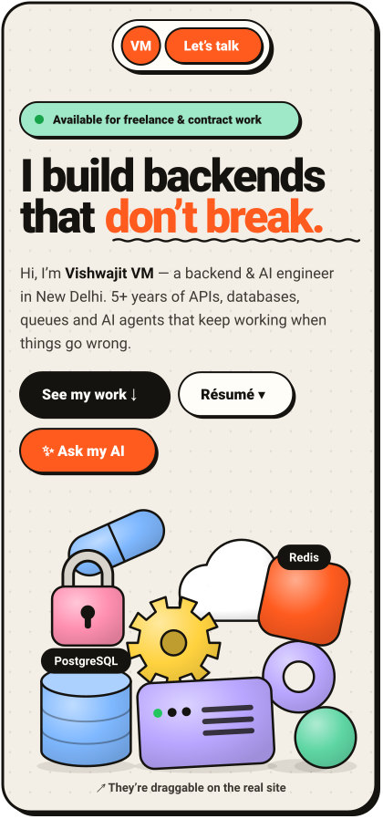
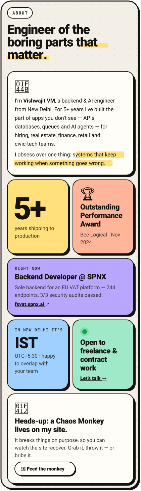
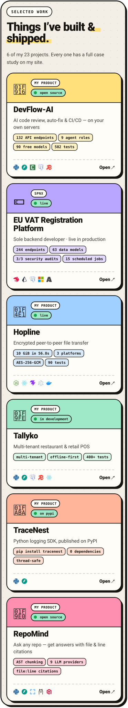
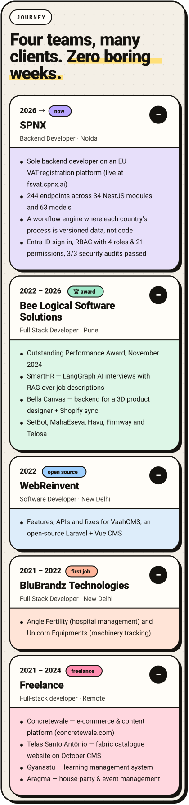
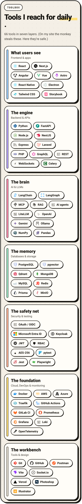
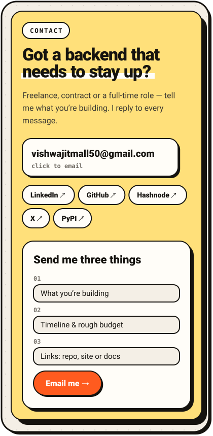
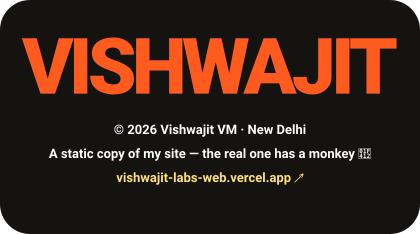

<a href="https://vishwajit-labs-web.vercel.app"><picture><source media="(min-width: 768px)" srcset="img/site/hero-wide.svg"></picture></a>

<a href="https://vishwajit-labs-web.vercel.app/#about"><picture><source media="(min-width: 768px)" srcset="img/site/about-wide.svg"></picture></a>

<a href="https://vishwajit-labs-web.vercel.app/#work"><picture><source media="(min-width: 768px)" srcset="img/site/work-wide.svg"></picture></a>

<b>Open a project →</b> <a href="https://github.com/vishwajitvm/DevFlow-AI">DevFlow-AI</a> · <a href="https://fsvat.spnx.ai/">EU VAT Platform</a> · <a href="https://github.com/vishwajitvm/Hopline">Hopline</a> · <a href="https://github.com/vishwajitvm/Tallyko">Tallyko</a> · <a href="https://github.com/vishwajitvm/TraceNest">TraceNest</a> · <a href="https://github.com/vishwajitvm/RepoMind">RepoMind</a>

<b>All 23 projects</b>

 

**My products**

- 🤖 **[DevFlow-AI](https://github.com/vishwajitvm/DevFlow-AI)** · AI code review, auto-fix & CI/CD — on your own servers
- 📡 **[Hopline](https://github.com/vishwajitvm/Hopline)** · Encrypted peer-to-peer file transfer · [live](https://hopline.onrender.com)
- 🧾 **[Tallyko](https://github.com/vishwajitvm/Tallyko)** · Multi-tenant restaurant & retail POS
- 🪺 **[TraceNest](https://github.com/vishwajitvm/TraceNest)** · Python logging SDK, published on PyPI · [PyPI](https://pypi.org/project/tracenest/)
- 🧠 **[RepoMind](https://github.com/vishwajitvm/RepoMind)** · Ask any repo — get answers with file & line citations
- 🐝 **[AgentHive](https://github.com/vishwajitvm/AgentHive)** · Multi-agent orchestration platform
- 🏢 **[TenantMind-AI](https://github.com/vishwajitvm/TenantMind-AI)** · Multi-tenant AI for property management
- 📚 **[PolicyBot](https://github.com/vishwajitvm/PolicyBot)** · RAG Q&A over internal documents
- 🐚 **[OmniShell](https://github.com/vishwajitvm/OmniShell)** · Plain English → OS workflows, with human approval
- 🗺️ **[LokTathya](https://github.com/vishwajitvm/LokTathya)** · Civic data platform for India
- 🥗 **[FitTrack-AI](https://github.com/vishwajitvm/FitTrack-AI)** · Nutrition from a photo of your meal

**Client & company work**

- 💶 **[EU VAT Registration Platform](https://fsvat.spnx.ai/)** · Sole backend developer · live in production
- 🎙️ **[SmartHR](https://vishwajit-labs-web.vercel.app/projects/smart-hr-bot)** · AI interview platform
- 👕 **[Bella Canvas](https://www.bellacanvas.com/)** · 3D product customisation & e-commerce
- 💜 **[Havu](https://havusocial.com/)** · Events-based dating platform
- 🏠 **[MahaEseva.com](https://vishwajit-labs-web.vercel.app/projects/mahaeseva)** · Online rent agreements for India
- 🗓️ **[SetBot](https://vishwajit-labs-web.vercel.app/projects/setbot)** · Property & venue booking platform
- 🧩 **[VaahCMS](https://vaah.dev/cms)** · Open-source Laravel CMS
- 🚜 **[Unicorn Equipments](https://unicornequipments.com/)** · Equipment tracking dashboard

**Freelance**

- 🏗️ **[Concretewale](https://github.com/vishwajitvm/concreatwala)** · E-commerce & content platform for concrete construction · [live](https://www.concretewale.com/)
- 🧵 **[Telas Santo Antônio](https://github.com/vishwajitvm/Daniela)** · Fabric company website & catalogue on October CMS · [live](https://www.telassantoantonio.com.br/)
- 🎓 **[Gyanastu](https://github.com/vishwajitvm/gyanastu_laravel)** · Learning management system
- 🎉 **[Aragma](https://github.com/vishwajitvm/aragma)** · House-party & event management system

<a href="https://vishwajit-labs-web.vercel.app/#timeline"><picture><source media="(min-width: 768px)" srcset="img/site/journey-wide.svg"></picture></a>

<a href="https://vishwajit-labs-web.vercel.app/#skills"><picture><source media="(min-width: 768px)" srcset="img/site/toolbox-wide.svg"></picture></a>

<a href="mailto:vishwajitmall50@gmail.com"><picture><source media="(min-width: 768px)" srcset="img/site/contact-wide.svg"></picture></a>

  <a href="mailto:vishwajitmall50@gmail.com"><b>✉️ Email</b></a> &nbsp;·&nbsp;
  <a href="https://www.linkedin.com/in/vishwajit-vm-179a61149"><b>LinkedIn</b></a> &nbsp;·&nbsp;
  <a href="https://hashnode.com/@Vishwajitvm"><b>Hashnode</b></a> &nbsp;·&nbsp;
  <a href="https://www.twitter.com/VishwajitVm"><b>X</b></a> &nbsp;·&nbsp;
  <a href="https://pypi.org/user/vishwajitvm/"><b>PyPI</b></a> &nbsp;·&nbsp;
  <a href="https://vishwajit-labs-web.vercel.app/assets/resume-backend.pdf"><b>📄 Résumé</b></a>

<b>✍️ Things I’ve written</b>

 

- [Getting Started with LangChain: A Beginner's Guide](https://vishwajitvm.hashnode.dev/getting-started-with-langchain-a-beginners-guide)
- [Build a Chatbot with Node.js and OpenAI API](https://vishwajitvm.hashnode.dev/build-a-chatbot-with-nodejs-and-openai-api)
- [Laravel Tips and Tricks: Become a Pro in No Time](https://vishwajitvm.hashnode.dev/laravel-tips-and-tricks-become-a-pro-in-no-time)
- [Improve Your Debugging Skills with Laravel Telescope](https://vishwajitvm.hashnode.dev/improve-your-debugging-skills-with-laravel-telescope)
- [Integrate Razorpay Payment Gateway in Laravel](https://vishwajitvm.hashnode.dev/integrate-razorpay-payment-gateway-in-laravel)

<a href="https://vishwajit-labs-web.vercel.app"><picture><source media="(min-width: 768px)" srcset="img/site/footer-wide.svg"></picture></a>

