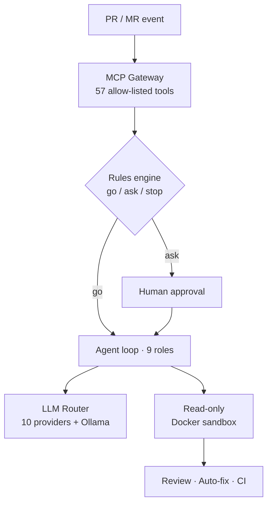
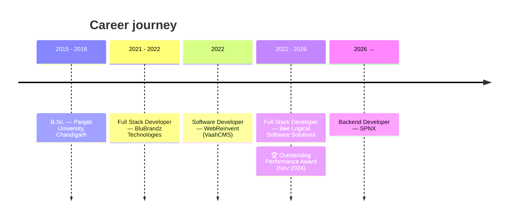

<!-- ================================================================= -->
<!--                        VISHWAJIT VM · PROFILE                       -->
<!-- ================================================================= -->

<p align="center">
  
</p>

<p align="center">
  <a href="https://vishwajit-labs-web.vercel.app/">
    
  </a>
</p>

<p align="center">
  <a href="https://vishwajit-labs-web.vercel.app/"></a>
  <a href="https://www.linkedin.com/in/vishwajit-vm-179a61149"></a>
  <a href="https://pypi.org/user/vishwajitvm/"></a>
  <a href="mailto:vishwajitmall50@gmail.com"></a>
</p>

<p align="center">
  
  
  
</p>

<p align="center">
  <a href="#-about-me"><b>About</b></a> ·
  <a href="#-flagship-project--devflow-ai"><b>Flagship</b></a> ·
  <a href="#-featured-projects"><b>Projects</b></a> ·
  <a href="#-tech-stack"><b>Stack</b></a> ·
  <a href="#-experience"><b>Experience</b></a> ·
  <a href="#-github-at-a-glance"><b>Stats</b></a> ·
  <a href="#-writing"><b>Writing</b></a> ·
  <a href="#-lets-work-together"><b>Hire me</b></a>
</p>

---

## 🧭 About Me

```python
class VishwajitMall:
    role        = "Python Backend & AI/LLM Engineer"
    experience  = "5+ years · building production APIs since 2021"
    location    = "New Delhi, India 🇮🇳"
    currently   = "Backend Developer @ SPNX — sole backend dev on a production EU VAT platform"

    daily_stack = ["FastAPI", "Pydantic", "SQLAlchemy", "Celery", "Redis", "PostgreSQL", "Docker", "pytest"]
    ai_stack    = ["LangGraph", "LangChain", "MCP", "LiteLLM", "RAG", "Qdrant", "pgvector", "Ollama"]
    also_ship   = ["Node.js", "NestJS", "TypeScript", "Prisma", "React", "Next.js", "Laravel"]

    i_care_about = [
        "agents that are safe by default (allow-lists, approvals, sandboxes)",
        "RAG that cites its sources",
        "LLM routing that never falls over (fallbacks, cool-downs, local models)",
        "tests that let you ship on a Friday",
    ]

    open_to = "freelance · contract · remote roles in backend & AI engineering"
```

<details>
<summary><b>⚡ Quick facts</b> (click to expand)</summary>
<br>

| | |
|---|---|
| 💼 **Experience** | 5+ years (Aug 2021 → now) |
| 🏢 **Now** | Backend Developer · SPNX |
| 🏆 **Recognition** | Outstanding Performance Award · Bee Logical · Nov 2024 |
| 🐍 **Primary language** | Python · also TypeScript, JavaScript, PHP |
| 🧠 **AI focus** | Agents · RAG · tool calling · MCP · multi-provider LLM routing |
| 🗄️ **Data** | PostgreSQL · MongoDB · MySQL · Redis · Qdrant · pgvector |
| 🔐 **Security** | OAuth 2.0 / OIDC · Microsoft Entra ID · Keycloak · RBAC · 3 VAPT rounds cleared |
| 📦 **Published** | TraceNest on PyPI · 18 releases |
| 🎓 **Education** | B.Sc. · Panjab University, Chandigarh |

</details>

---

## 🏆 Flagship Project · DevFlow-AI

<table>
<tr>
<td width="60%" valign="top">

### 🤖 [DevFlow-AI](https://github.com/vishwajitvm/DevFlow-AI)
**Self-hosted AI code review, auto-fix & CI/CD platform for GitHub and GitLab.**

- 🧩 **132** API endpoints · **31** tables · **30** Celery tasks · **17** Docker services
- 🧠 Framework-free **tool-calling agent loop** for **9 roles** — analyst, fixer, code & security reviewers — with JSON-schema-validated output, token budgets and AST caller-compatibility checks
- 🔀 **LLM router** across **90 free models / 10 providers** with Retry-After cool-downs and local **Ollama** fallback
- 🛡️ Every GitHub/GitLab write goes through **one MCP gateway** (57 allow-listed tools) with one-time keys and a deny-by-default *go / ask / stop* rules engine
- 🧪 Reviews run in **no-network, read-only Docker sandboxes** · **392** unit · **67** API e2e · **43** Playwright tests in GitHub Actions & GitLab CI

</td>
<td width="40%" valign="top">



</td>
</tr>
</table>

<p align="center">
  
</p>

---

## 🚀 Featured Projects

<table>
<tr>
<td width="50%" valign="top">

### 🔁 [Hopline](https://github.com/vishwajitvm/Hopline) &nbsp;<a href="https://hopline.onrender.com"></a>
**Encrypted peer-to-peer file transfer** — browser, desktop (Electron for Windows, macOS, Linux) and CLI.
- WebRTC + Node.js WebSocket signaling
- Encrypted TCP transfer with **CPace PAKE · HKDF · AES-256-GCM**
- ⚡ **10 GiB in 56.8 s**, SHA-256 verified

`Node.js` `WebRTC` `React 19` `Electron` `Docker`

</td>
<td width="50%" valign="top">

### 🧾 [Tallyko](https://github.com/vishwajitvm/Tallyko) &nbsp;
**Multi-tenant restaurant & retail POS.**
- FastAPI · **PostgreSQL row-level security** · 38 tables · Redis
- Offline-first **React Native (Expo)** app that syncs queued bills without duplicates
- Local OCR menu import · **400+ automated tests**

`FastAPI` `PostgreSQL` `Redis` `React Native` `MinIO`

</td>
</tr>
<tr>
<td width="50%" valign="top">

### 🧠 [RepoMind](https://github.com/vishwajitvm/RepoMind)
**Ask questions about any GitHub repo — get answers with file & line citations.**
- LangGraph + FastAPI · AST-based code chunking
- Qdrant vector search + live GitHub API lookups
- 9-provider LLM fallback

`LangGraph` `FastAPI` `Qdrant` `React` `TypeScript`

</td>
<td width="50%" valign="top">

### 🐚 [OmniShell](https://github.com/vishwajitvm/OmniShell)
**Natural-language → OS workflows, with human approval.**
- 19 capability types on Linux, macOS & Windows
- One LiteLLM planning call with Pydantic-validated JSON · 6-provider fallback
- PostgreSQL scheduler with `FOR UPDATE SKIP LOCKED`, heartbeat leases & expiring approval tokens

`FastAPI` `LiteLLM` `PostgreSQL` `Redis` `NestJS`

</td>
</tr>
<tr>
<td width="50%" valign="top">

### 🇮🇳 [LokTathya](https://github.com/vishwajitvm/LokTathya) &nbsp;
**Civic data & grounded-AI platform for India.**
- FastAPI · Next.js · PostgreSQL/PostGIS · 50 tables
- GitHub Actions pipeline running migrations + 76 tests
- Grounded RAG over public information

`FastAPI` `Next.js` `PostGIS` `RAG`

</td>
<td width="50%" valign="top">

### 📦 [TraceNest](https://github.com/vishwajitvm/TraceNest) &nbsp;<a href="https://pypi.org/project/tracenest/"></a>
**Zero-dependency, thread-safe Python logging SDK.**
- Daily rotation · recursive secret masking · FastAPI middleware
- Built-in log viewer · 42 tests · 18 releases
- Used in DevFlow-AI and OmniShell

```bash
pip install tracenest
```

</td>
</tr>
</table>

<details>
<summary><b>🧪 More AI projects</b> (click to expand)</summary>
<br>

| Project | What it does | Stack |
|---|---|---|
| 🏘️ [**TenantMind-AI**](https://github.com/vishwajitvm/TenantMind-AI) | Multi-tenant AI property management — database-per-tenant, per-tenant Qdrant collections, LLM gateway with fallback that logs latency & tokens per call | FastAPI · MongoDB · Keycloak · Qdrant · Celery |
| 🐝 [**AgentHive**](https://github.com/vishwajitvm/AgentHive) | ReAct multi-agent platform — DB-configured LLM router, 40 tools with per-agent allow-lists, pgvector memory | FastAPI · PostgreSQL · pgvector · Celery · Next.js |
| 📚 [**PolicyBot**](https://github.com/vishwajitvm/PolicyBot) | Hybrid RAG for company policies — vector + keyword retrieval, freshness-aware ranking, citations & confidence scores | FastAPI · Qdrant · MongoDB · LangGraph · React |
| 🗣️ **NL-Automation-Platform** | Plain-English automations on 6 FastAPI microservices with a LangGraph clarification agent and a fail-closed safety classifier | FastAPI · LangGraph |
| 🥗 **FitTrack-AI** | Meal nutrition from a photo via vision LLMs, grounded in USDA & Open Food Facts | Next.js · FastAPI |

</details>

---

## 🧰 Tech Stack

<p align="center">
  <br>
  <br>
  <br>
  
</p>

<details>
<summary><b>🤖 AI / LLM engineering</b></summary>
<br>
<p>


</p>
<p><b>Providers I route across:</b> OpenAI · Gemini · Groq · Mistral · NVIDIA NIM · OpenRouter · Hugging Face · Ollama</p>
</details>

<details>
<summary><b>🔐 Security, testing & observability</b></summary>
<br>
<p>


</p>
</details>

---

## 💼 Experience



<details open>
<summary><b>🏢 SPNX — Backend Developer</b> &nbsp;·&nbsp; Oct 2026 → present</summary>
<br>

**FLO — VAT registration platform** · `NestJS 11` `TypeScript` `PostgreSQL 17` `Prisma 7` `Microsoft Entra ID` `Azure` `Jest`

- Sole backend developer of a staff workspace + client portal that runs **EU VAT registrations** — **244** REST operations, **34** NestJS modules, **63** Prisma models
- Designed a **data-driven workflow engine** that runs each country's process as versioned data; the same guards enforce business rules and return each user's allowed actions
- **Entra ID (OIDC)** sign-in, Postgres-backed sessions with CSRF protection, **RBAC with 4 roles & 21 permissions**
- Cleared **3 security-test (VAPT) rounds** · 63 Jest spec files · 24-suite API end-to-end harness

</details>

<details>
<summary><b>🐝 Bee Logical Software Solutions — Full Stack Developer</b> &nbsp;·&nbsp; Nov 2022 → Jun 2026</summary>
<br>

Core backend developer on production platforms; designed APIs, data models and auth, and shipped LLM features with the AI/ML team. **🏆 Outstanding Performance Award — Nov 2024.**

| Product | What I built | Stack |
|---|---|---|
| 🤖 **SmartHR** | AI interview platform — LangGraph pipeline for stateful multi-turn interviews, RAG over job descriptions, agent-based scoring & reports | FastAPI · LangChain · LangGraph · Gemini · MongoDB |
| 🏨 **SetBot** | Property booking APIs for studios, hostels, restaurants & shops · JWT + RBAC across 4 roles | Node.js · Express · TypeScript · MySQL · Angular |
| 🛍️ **Bella Canvas** | Led backend for a 5-stage 3D product-design lifecycle · Shopify order sync · S3 texture pipeline | Laravel · Vue.js · AWS RDS/S3 · Shopify API |
| 🏠 **MahaEseva** | Government-compliant online rent agreements with e-sign, payments & biometric verification | Laravel · MySQL |
| ❤️ **Havu** | Admin portal for an events-based dating app across multiple cities | React · GraphQL · AWS Amplify |
| 💳 **Firmway** | Balance confirmation & reconciliation workflows | FinTech · Automation |
| 🌐 **[Telosa](https://telosa.cx/)** | Customer-experience platform — locations, listings, leads, reputation | Integrations |

</details>

<details>
<summary><b>🧩 WebReinvent — Software Developer</b> &nbsp;·&nbsp; Jul 2022 → Oct 2022</summary>
<br>

Features & bug fixes in **VaahCMS**, an open-source Laravel + Vue.js CMS · `Laravel` `Vue.js` `MySQL` `REST APIs`

</details>

<details>
<summary><b>🏥 BluBrandz Technologies — Full Stack Developer</b> &nbsp;·&nbsp; Aug 2021 → Jun 2022</summary>
<br>

Built **Angle Fertility** (hospital management), **Aragma** (event management) and **Unicorn Equipments** (equipment tracking) · `Laravel` `MySQL`

</details>

---

## 📊 GitHub at a Glance

<p align="center">
  <picture>
    <source media="(prefers-color-scheme: dark)" srcset="https://github-profile-summary-cards.vercel.app/api/cards/stats?username=vishwajitvm&theme=github_dark" />
    
  </picture>
  <picture>
    <source media="(prefers-color-scheme: dark)" srcset="https://github-profile-summary-cards.vercel.app/api/cards/repos-per-language?username=vishwajitvm&theme=github_dark" />
    
  </picture>
</p>

<p align="center">
  <picture>
    <source media="(prefers-color-scheme: dark)" srcset="https://streak-stats.demolab.com?user=vishwajitvm&theme=tokyonight&hide_border=true" />
    
  </picture>
</p>

<details>
<summary><b>📈 Contribution activity</b> (click to expand)</summary>
<br>
<p align="center">
  
</p>
</details>

<p align="center">
  <picture>
    <source media="(prefers-color-scheme: dark)" srcset="https://raw.githubusercontent.com/vishwajitvm/vishwajitvm/output/github-snake-dark.svg" />
    
  </picture>
</p>

---

## ✍️ Writing

| | Article |
|---|---|
| 📚 | [Getting Started with LangChain: A Beginner's Guide](https://vishwajitvm.hashnode.dev/getting-started-with-langchain-a-beginners-guide) |
| 🤖 | [Build a Chatbot with Node.js and OpenAI API](https://vishwajitvm.hashnode.dev/build-a-chatbot-with-nodejs-and-openai-api) |
| 🧩 | [Laravel Tips and Tricks: Become a Pro in No Time](https://vishwajitvm.hashnode.dev/laravel-tips-and-tricks-become-a-pro-in-no-time) |
| 🔎 | [Improve Your Debugging Skills with Laravel Telescope](https://vishwajitvm.hashnode.dev/improve-your-debugging-skills-with-laravel-telescope) |
| 💳 | [Integrate Razorpay Payment Gateway in Laravel](https://vishwajitvm.hashnode.dev/integrate-razorpay-payment-gateway-in-laravel) |

---

## 🤝 Let's Work Together

<p align="center">
  <b>Open to freelance, contract & remote roles in</b><br><br>
  
  
  
  
  
</p>

<p align="center">
  <a href="mailto:vishwajitmall50@gmail.com"></a>
  <a href="https://www.linkedin.com/in/vishwajit-vm-179a61149"></a>
  <a href="https://vishwajit-labs-web.vercel.app/"></a>
</p>

<p align="center">
  <a href="https://www.twitter.com/VishwajitVm"></a>
  <a href="https://hashnode.com/@Vishwajitvm"></a>
  <a href="https://www.codepen.io/vishwajitvm"></a>
  <a href="https://www.youtube.com/channel/UCldd1WpTGf1uX1ZDdNH20IA"></a>
  <a href="https://www.buymeacoffee.com/vishwajitm7"></a>
</p>

<p align="center">
  
</p>

<p align="center">
  
</p>
