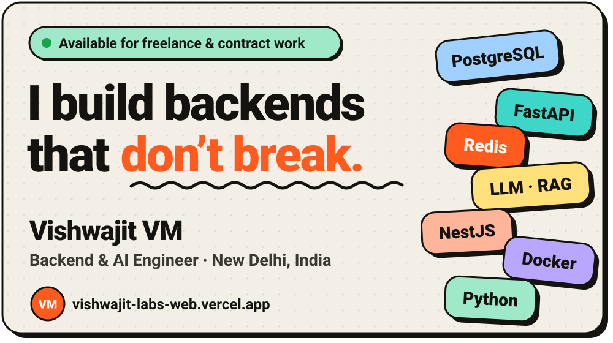
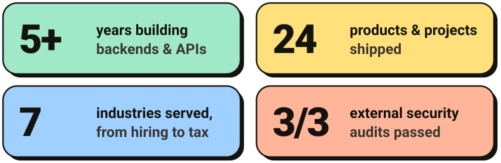
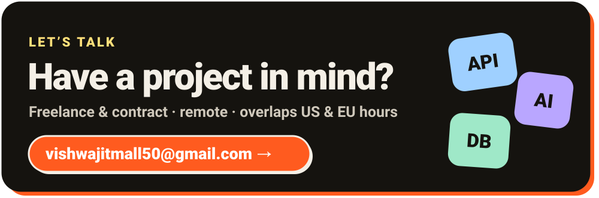

  <a href="https://vishwajit-labs-web.vercel.app/"><b>🌐 Portfolio</b></a> &nbsp;·&nbsp;
  <a href="https://www.linkedin.com/in/vishwajit-vm-179a61149"><b>💼 LinkedIn</b></a> &nbsp;·&nbsp;
  <a href="mailto:vishwajitmall50@gmail.com"><b>✉️ Email</b></a> &nbsp;·&nbsp;
  <a href="https://vishwajit-labs-web.vercel.app/assets/resume-backend.pdf"><b>📄 Résumé</b></a>

## 👋 About me

I build the part of apps you don't see: **servers, databases and APIs**, and lately **AI assistants and automations** that are genuinely useful. I care about the unglamorous things that keep products alive: clean data models, proper sign-in and permissions, tests, and logs you can actually read.

Right now I'm the only backend developer on **FLO**, an EU VAT registration platform at **SPNX**. Before that I spent nearly four years at Bee Logical shipping seven client products, and won their **Outstanding Performance Award** in 2024.

## 🛠️ What I can do for you

- 🤖 **AI assistants & chatbots**: answer questions from your documents and data, and show where each answer came from.
- ⚙️ **Backends & APIs**: fast, secure and documented, in Python (FastAPI) or TypeScript (NestJS, Node.js).
- 🧩 **AI automation & agents**: agents that only use the tools you approve, and ask before they act.
- 🔐 **Secure business platforms**: sign-in, roles and permissions, audit trails, and tests that pass security reviews.

## 💼 Experience

<b>🟠 SPNX</b> · Backend Developer · Noida · <i>Oct 2026 – now</i>

 

I'm the only backend developer on **FLO**, a platform that handles **EU VAT (tax) registrations** for businesses. It has a workspace for staff and a portal for clients.

- Built the entire server side: 244 API operations across 34 modules
- Designed a workflow engine where each country's tax process is set up as configuration, not code
- Set up Microsoft sign-in and permissions (4 roles, 21 permissions)
- Passed **3 rounds of independent security testing**

`NestJS` `TypeScript` `PostgreSQL` `Prisma` `Microsoft Entra ID` `Azure` `Jest`

<b>🟢 Bee Logical Software Solutions</b> · Full Stack Developer · Pune · <i>Nov 2022 – Jun 2026</i>

 

Seven live products for clients in hiring, real estate, e-commerce, dating, finance and customer experience. 
🏆 **Outstanding Performance Award, November 2024**

- **SmartHR**: an AI interviewer that screens candidates and runs first-round interviews. I built the AI interview flow and the part that reads job descriptions.
- **SetBot**: booking for homes, hostels, studios, restaurants and shops. I built its booking APIs and access control for 4 types of users.
- **Bella Canvas**: a 3D product designer with an online store. I led the backend: the 5-step design process, Shopify order sync and image storage.
- **MahaEseva**: online rent agreements that meet government rules, with e-signing, payments and biometric checks.
- **Havu**: an admin portal for a dating app built around real-world events in several cities.
- **Firmway**: financial software for balance confirmations and reconciliation.
- **[Telosa](https://telosa.cx/)**: a customer-experience platform for multi-location businesses: listings, leads and reputation.

`FastAPI` `LangChain` `LangGraph` `Gemini` `Node.js` `Express` `Angular` `Laravel` `Vue.js` `React` `GraphQL` `AWS` `MongoDB` `MySQL`

<b>🔵 WebReinvent</b> · Software Developer · New Delhi · <i>Jul – Oct 2022</i>

 

Built features, backend modules and APIs, and fixed bugs in **VaahCMS**, an open-source content management system.

`Laravel` `Vue.js` `MySQL`

<b>🟣 BluBrandz Technologies</b> · Full Stack Developer · New Delhi · <i>Aug 2021 – Jun 2022</i>

 

My first role. I built three web apps:

- **Angle Fertility**: hospital management covering patient records, appointments and clinical workflows
- **Aragma**: house-party and event management covering guests, spending and staff
- **Unicorn Equipments**: tracking and maintenance for machinery

`Laravel` `MySQL`

## 🚀 Projects

Things I've built on my own.

**⭐ [DevFlow-AI](https://github.com/vishwajitvm/DevFlow-AI)**: an AI teammate that reviews code, suggests fixes and runs tests on your own servers, for GitHub and GitLab. 132 API endpoints, 90 free AI models from 10 providers, 502 automated tests. 
`FastAPI` `Next.js` `PostgreSQL` `Redis` `Celery` `MCP` `Docker`

**📦 [Hopline](https://hopline.onrender.com)** (live demo): send big files straight between devices, encrypted end to end, with no cloud storage in the middle. 10 GiB in 56.8 s. 
`Node.js` `React` `Electron` `WebRTC` `AES‑256`

**🧾 [Tallyko](https://github.com/vishwajitvm/Tallyko)**: billing and ordering for restaurants and shops that keeps working offline. 
`FastAPI` `React Native` `PostgreSQL` `Redis` `MinIO`

**🧠 [RepoMind](https://github.com/vishwajitvm/RepoMind)**: ask any GitHub project a question; answers point to the exact file and line. 
`LangGraph` `Qdrant` `React`

**🔎 [LokTathya](https://github.com/vishwajitvm/LokTathya)**: makes India's public information easier to find, check and understand. 
`Next.js` `FastAPI` `MinIO`

**💻 [OmniShell](https://github.com/vishwajitvm/OmniShell)**: describe a task in plain English; it runs the steps once you approve them. 
`Python` `LiteLLM` `AI agents`

**🪵 [TraceNest](https://pypi.org/project/tracenest/)**: a zero-dependency Python logging library that hides passwords and keys automatically. Try it: `pip install tracenest` 
`Python` `PyPI`

<b>5 more AI projects</b>

 

- **[TenantMind-AI](https://github.com/vishwajitvm/TenantMind-AI)**: an AI assistant for property managers, with each client's data kept completely separate. `FastAPI` `MongoDB` `Qdrant` `Celery`
- **[AgentHive](https://github.com/vishwajitvm/AgentHive)**: several AI agents working together, each limited to its own approved tools. `FastAPI` `PostgreSQL` `pgvector`
- **[PolicyBot](https://github.com/vishwajitvm/PolicyBot)**: answers staff questions from company policy documents, with sources and a confidence score. `FastAPI` `Qdrant` `Gemini`
- **NL-Automation-Platform**: turns plain-English requests into automations, and refuses anything unsafe. `FastAPI` `LangGraph`
- **FitTrack-AI**: snap a photo of a meal and get its nutrition, checked against USDA data. `Next.js` `FastAPI`

## 🧰 Toolbox

**⚙️ Backend & APIs** 
`Python` `FastAPI` `Node.js` `NestJS` `Express` `Laravel` `PHP` `GraphQL` `REST` `WebSockets` `Celery`

**🧠 AI & LLMs** 
`LangChain` `LangGraph` `MCP` `RAG` `AI agents` `LiteLLM` `OpenAI` `Gemini` `Ollama` `NumPy` `Pandas`

**🗄️ Databases & storage** 
`PostgreSQL` `pgvector` `Qdrant` `MongoDB` `MySQL` `Redis` `Prisma` `MinIO`

**🔐 Security & testing** 
`OAuth / OIDC` `Microsoft Entra ID` `Keycloak` `JWT` `RBAC` `AES‑256` `pytest` `Jest` `Playwright`

**☁️ Cloud, DevOps & monitoring** 
`Docker` `AWS` `Azure` `Traefik` `GitHub Actions` `GitLab CI` `Prometheus` `Grafana` `Loki` `OpenTelemetry`

**🎨 Frontend & apps** 
`React` `Next.js` `Angular` `Vue` `Astro` `React Native` `Electron` `Tailwind CSS` `Storybook`

**🧪 Tools** 
`Git` `GitHub` `Postman` `Vite` `Socket.io` `Vercel` `Photoshop` `Illustrator`

## ✍️ Writing

- [Getting Started with LangChain: A Beginner's Guide](https://vishwajitvm.hashnode.dev/getting-started-with-langchain-a-beginners-guide)
- [Build a Chatbot with Node.js and OpenAI API](https://vishwajitvm.hashnode.dev/build-a-chatbot-with-nodejs-and-openai-api)
- [Laravel Tips and Tricks: Become a Pro in No Time](https://vishwajitvm.hashnode.dev/laravel-tips-and-tricks-become-a-pro-in-no-time)
- [Improve Your Debugging Skills with Laravel Telescope](https://vishwajitvm.hashnode.dev/improve-your-debugging-skills-with-laravel-telescope)
- [Integrate Razorpay Payment Gateway in Laravel](https://vishwajitvm.hashnode.dev/integrate-razorpay-payment-gateway-in-laravel)

## 📫 Contact

**Find me online:** [LinkedIn](https://www.linkedin.com/in/vishwajit-vm-179a61149) · [Portfolio](https://vishwajit-labs-web.vercel.app/) · [X](https://www.twitter.com/VishwajitVm) · [Hashnode](https://hashnode.com/@Vishwajitvm) · [YouTube](https://www.youtube.com/channel/UCldd1WpTGf1uX1ZDdNH20IA) · [CodePen](https://www.codepen.io/vishwajitvm) · [PyPI](https://pypi.org/user/vishwajitvm/) · [Buy me a coffee ☕](https://www.buymeacoffee.com/vishwajitm7)

🐶 <b>Psst… Byte the puppy still lives here</b>

 

🦴 Give Byte a treat

> 🐶💨 *Byte zooms over…* **CHOMP!** 🦴 → 😋 "Thank you!" He does a happy little spin. 🌀

🎾 Throw the ball really far

> 🎾✈️ … it lands somewhere in **Projects**. Byte comes back carrying **DevFlow-AI** instead. "Look what I found! 🤖"

✋ Pet Byte

> 🐶 → 🥰 Byte rolls over for belly rubs. ❤️❤️❤️ *Friendship level: MAX.* "Now go say hi to my human!"

