  <a href="#get-flagship"><code>GET /flagship</code></a>&nbsp;
  <a href="#get-services"><code>GET /services</code></a>&nbsp;
  <a href="#get-career"><code>GET /career</code></a>&nbsp;
  <a href="#get-stack"><code>GET /stack</code></a>&nbsp;
  <a href="#get-metrics"><code>GET /metrics</code></a>&nbsp;
  <a href="#post-hello"><code>POST /hello</code></a>

 

## GET /flagship

<code>200 OK</code> &nbsp;the one project I'd show you first

<b>▸ Inspect the request</b> &nbsp;what happens when a pull request opens

 

| step | what runs | why it matters |
|:--:|---|---|
| `1` | Webhook lands; a **Celery** task picks it up (30 task types, 17 Docker services) | the API never blocks on an LLM |
| `2` | Every GitHub/GitLab call goes through **one MCP gateway** — 57 allow-listed tools, one-time keys | the agent can't touch anything that isn't on the list |
| `3` | A deny-by-default **rules engine** answers *go / ask / stop* | risky writes wait for a human |
| `4` | A framework-free **tool-calling loop** runs 9 roles — analyst, fixer, code & security reviewers — with JSON-schema output, token budgets and AST caller checks | answers are validated, not trusted |
| `5` | The **LLM router** spreads load over 90 free models / 10 providers, honours `Retry-After`, falls back to local **Ollama** | rate limits don't stop a review |
| `6` | Code runs in a **no-network, read-only Docker sandbox** | nothing leaks, nothing gets written by accident |

Tested by 392 unit · 67 API end-to-end · 43 Playwright tests in GitHub Actions and GitLab CI.

 

## GET /services

<code>200 OK</code> &nbsp;6 services running · click any card for the repo

  
  

  
  

  
  

Hopline is live → <a href="https://hopline.onrender.com">hopline.onrender.com</a>

<b>▸ <code>GET /services?page=2</code></b> &nbsp;5 more AI systems

 

| service | what it does | built with |
|---|---|---|
| [**TenantMind-AI**](https://github.com/vishwajitvm/TenantMind-AI) | Multi-tenant AI property management — a database per tenant, a Qdrant collection per tenant, an LLM gateway that logs latency and tokens on every call | FastAPI · MongoDB · Keycloak · Qdrant · Celery |
| [**AgentHive**](https://github.com/vishwajitvm/AgentHive) | ReAct multi-agent platform — LLM router configured from the database, 40 tools with per-agent allow-lists, pgvector memory | FastAPI · PostgreSQL · pgvector · Next.js |
| [**PolicyBot**](https://github.com/vishwajitvm/PolicyBot) | Hybrid RAG over company policies — vector + keyword retrieval, freshness-aware ranking, citations and confidence scores | FastAPI · Qdrant · LangGraph · React |
| **NL-Automation-Platform** | Plain-English automations across 6 microservices, with a clarifying agent and a fail-closed safety classifier | FastAPI · LangGraph |
| **FitTrack-AI** | Meal nutrition from a photo, grounded in USDA and Open Food Facts data | Next.js · FastAPI · vision LLMs |

 

## GET /career

<code>200 OK</code> &nbsp;5+ years, every release shipped to production

Click a commit to <code>git show</code> it.

<code>HEAD</code> &nbsp;<b>feat(spnx):</b> sole backend for FLO, an EU VAT registration platform &nbsp;Oct 2026 → now

 

Staff workspace + client portal that runs EU VAT registrations end to end.

- **244** REST operations · **34** NestJS modules · **63** Prisma models
- A **data-driven workflow engine**: each country's process is versioned data, and the same guards that enforce the rules return each user's allowed actions
- **Microsoft Entra ID** sign-in, Postgres-backed sessions with CSRF protection, **RBAC** with 4 roles and 21 permissions
- Cleared **3 security-test (VAPT) rounds** · 63 Jest spec files · a 24-suite API end-to-end harness

`NestJS 11` `TypeScript` `PostgreSQL 17` `Prisma 7` `Entra ID` `Azure` `Jest`

<code>v2022.11</code> &nbsp;<b>feat(bee-logical):</b> SmartHR, SetBot, Bella Canvas and 4 more products &nbsp;Nov 2022 → Jun 2026

 

Core backend developer on production platforms — APIs, data models, auth, and LLM features with the AI/ML team. **🏆 Outstanding Performance Award, Nov 2024.**

| product | what I built | stack |
|---|---|---|
| **SmartHR** | AI interview platform — LangGraph pipeline for stateful multi-turn interviews, RAG over job descriptions, agent-based scoring and reports | FastAPI · LangGraph · Gemini · MongoDB |
| **SetBot** | Booking APIs for studios, hostels, restaurants and shops, with JWT + RBAC across 4 roles | Node.js · Express · TypeScript · MySQL |
| **Bella Canvas** | Led the backend for a 5-stage 3D product-design lifecycle, Shopify order sync and an S3 texture pipeline | Laravel · Vue.js · AWS · Shopify API |
| **MahaEseva** | Government-compliant online rent agreements with e-sign, payments and biometric checks | Laravel · MySQL |
| **Havu** | Admin portal for an events-based dating app across several cities | React · GraphQL · AWS Amplify |
| **Firmway** | Balance confirmation and reconciliation workflows | FinTech |
| [**Telosa**](https://telosa.cx/) | Customer-experience platform — locations, listings, leads, reputation | Integrations |

<code>v2022.07</code> &nbsp;<b>feat(webreinvent):</b> features and fixes in VaahCMS &nbsp;Jul → Oct 2022

 

Worked on **VaahCMS**, an open-source Laravel + Vue.js CMS. &nbsp;`Laravel` `Vue.js` `MySQL`

<code>v2021.08</code> &nbsp;<b>init(blubrandz):</b> first production apps &nbsp;Aug 2021 → Jun 2022

 

Built **Angle Fertility** (hospital management), **Aragma** (event management) and **Unicorn Equipments** (equipment tracking). &nbsp;`Laravel` `MySQL`

 

## GET /stack

<code>200 OK</code> &nbsp;follow the packet down the layers

<b>▸ Cross-cutting concerns</b> &nbsp;security, testing, observability, LLM providers

 

| concern | what I use |
|---|---|
| **Identity & access** | OAuth 2.0 / OIDC · Microsoft Entra ID · Keycloak · JWT · RBAC |
| **Secrets & crypto** | Azure Key Vault · AES-256-GCM · CPace PAKE |
| **Testing** | pytest · Jest · Playwright · API end-to-end harnesses |
| **Observability** | OpenTelemetry · Prometheus · Grafana |
| **LLM providers I route across** | OpenAI · Gemini · Groq · Mistral · NVIDIA NIM · OpenRouter · Hugging Face · Ollama |

 

## GET /metrics

<code>200 OK</code> &nbsp;live from GitHub

  

<b>▸ Commit activity, last 31 days</b>

 

<b>▸ <code>GET /posts</code></b> &nbsp;things I've written on Hashnode

 

- [Getting Started with LangChain: A Beginner's Guide](https://vishwajitvm.hashnode.dev/getting-started-with-langchain-a-beginners-guide)
- [Build a Chatbot with Node.js and OpenAI API](https://vishwajitvm.hashnode.dev/build-a-chatbot-with-nodejs-and-openai-api)
- [Laravel Tips and Tricks: Become a Pro in No Time](https://vishwajitvm.hashnode.dev/laravel-tips-and-tricks-become-a-pro-in-no-time)
- [Improve Your Debugging Skills with Laravel Telescope](https://vishwajitvm.hashnode.dev/improve-your-debugging-skills-with-laravel-telescope)
- [Integrate Razorpay Payment Gateway in Laravel](https://vishwajitvm.hashnode.dev/integrate-razorpay-payment-gateway-in-laravel)

 

## POST /hello

<code>201 Created</code> &nbsp;the best requests start with an email

  <a href="mailto:vishwajitmall50@gmail.com"><code>email ↗</code></a>&nbsp;
  <a href="https://www.linkedin.com/in/vishwajit-vm-179a61149"><code>linkedin ↗</code></a>&nbsp;
  <a href="https://vishwajit-labs-web.vercel.app/"><code>portfolio ↗</code></a>&nbsp;
  <a href="https://hashnode.com/@Vishwajitvm"><code>hashnode ↗</code></a>&nbsp;
  <a href="https://pypi.org/user/vishwajitvm/"><code>pypi ↗</code></a>&nbsp;
  <a href="https://www.twitter.com/VishwajitVm"><code>x ↗</code></a>&nbsp;
  <a href="https://www.youtube.com/channel/UCldd1WpTGf1uX1ZDdNH20IA"><code>youtube ↗</code></a>&nbsp;
  <a href="https://www.buymeacoffee.com/vishwajitm7"><code>coffee ↗</code></a>

 

  Every panel on this page is a hand-written SVG — <a href="assets">view the source</a>. 
  

