

  
  
  
  
  
  
  
  
  
  
  
  
  

  <a href="#about">👋 <b>About</b></a> &nbsp;•&nbsp; <a href="#featured">⭐ <b>Featured</b></a> &nbsp;•&nbsp; <a href="#projects">🗂️ <b>All projects</b></a> &nbsp;•&nbsp; <a href="#stack">🧰 <b>Tech stack</b></a> &nbsp;•&nbsp; <a href="#experience">💼 <b>Experience</b></a> &nbsp;•&nbsp; <a href="#contact">📬 <b>Contact</b></a>

 

## 👋 About me

<picture><source media="(prefers-color-scheme: dark)" srcset="assets/glance-dark.svg"></picture>

### I build the backends that products quietly depend on.

Hi, I’m **Vishwajit** — a backend &amp; AI engineer from New Delhi. For **5+ years** I’ve designed the parts of products you never see but always feel: **APIs that answer fast, data models that stay consistent, background jobs that never double-run, and AI agents that ask before they act.** My rule is simple: *a system should keep working when something goes wrong.*

<table>
<tr>
<td width="50%" valign="top">

#### 🔭 Right now
Sole backend developer at **SPNX**, running an [EU VAT-registration platform](https://fsvat.spnx.ai/) in production: **244 endpoints · 63 data models · 15 scheduled jobs · 3/3 security audits passed.**

</td>
<td width="50%" valign="top">

#### 🌱 After hours
Building **[DevFlow-AI](https://github.com/vishwajitvm/DevFlow-AI)** (self-hosted AI code review), **[Hopline](https://github.com/vishwajitvm/Hopline)** (encrypted P2P transfer, 10 GiB in 56.8 s) and **[Strutvane](https://github.com/vishwajit-vm)**, an open-source TypeScript framework.

</td>
</tr>
<tr>
<td width="50%" valign="top">

#### 🧠 How I work
Contracts first (OpenAPI, typed clients), boring tech where it counts (PostgreSQL, Redis), tests that hit real engines, and security designed in, not bolted on.

</td>
<td width="50%" valign="top">

#### 🤝 Let’s work together
**Open to freelance, contract and full-time roles** · IST, overlapping US &amp; EU hours. 
📫 **[vishwajitmall50@gmail.com](mailto:vishwajitmall50@gmail.com)** · I reply to every message.

</td>
</tr>
</table>

🏆 Outstanding Performance Award — Bee Logical Software Solutions, Nov 2024

 

## ⭐ Featured work

Click a card for the full case study · use the buttons for the live site, code and packages · open <b>Read more</b> for the details.

<table>
<tr>
<td width="50%" valign="top">
<a href="https://vishwajit-labs-web.vercel.app/projects/devflow-ai"><picture><source media="(prefers-color-scheme: dark)" srcset="assets/cards/devflow-ai-dark.svg"></picture></a>

 

<b>Read more</b>

 

DevFlow-AI is a self-hosted platform that reviews pull requests with AI, proposes and applies fixes, and runs CI/CD for GitHub and GitLab — while guaranteeing the AI never changes a repository without permission.

- 132 API endpoints, 31 database tables, 30 Celery background tasks and 17 Docker services.
- A framework-free tool-calling agent loop for 9 roles (analyst, fixer, code reviewer, security reviewer…) with JSON-schema-validated output, token budgets and AST checks that suggested code still fits its callers.
- An LLM router across 90 free models from 10 providers, with automatic cool-downs on rate limits and a local Ollama fallback.

</td>
<td width="50%" valign="top">
<a href="https://vishwajit-labs-web.vercel.app/projects/eu-vat-platform"><picture><source media="(prefers-color-scheme: dark)" srcset="assets/cards/eu-vat-platform-dark.svg"></picture></a>

 

<b>Read more</b>

 

A staff workspace and client portal that runs EU VAT registrations for overseas businesses — onboarding, documents, e-signatures and country-specific filing steps. I am the sole backend developer.

- 244 REST endpoints across 34 NestJS modules and 63 database models (PostgreSQL 17 + Prisma 7).
- A data-driven workflow engine that runs each country’s registration process as versioned data — the same rules decide which actions each user can take.
- Microsoft Entra ID (OIDC) sign-in, Postgres-backed sessions with CSRF protection, and role-based access with 4 roles and 21 permissions.

</td>
</tr>
<tr>
<td width="50%" valign="top">
<a href="https://vishwajit-labs-web.vercel.app/projects/hopline"><picture><source media="(prefers-color-scheme: dark)" srcset="assets/cards/hopline-dark.svg"></picture></a>

  

<b>Read more</b>

 

Hopline sends files directly between devices — browser, desktop and command line — encrypted end to end, with no upload server holding your data.

- A Node.js WebSocket signaling server and a WebRTC protocol sending 64 KiB frames over up to 4 parallel connections, with flow control, SHA-256 verification and resume after a disconnect.
- Encrypted TCP transfer for the CLI and desktop app (CPace PAKE key exchange, HKDF, AES-256-GCM): 10 GiB sent in 56.8 seconds with SHA-256 verification.
- An Electron desktop app and a React 19 + Vite web app.

</td>
<td width="50%" valign="top">
<a href="https://vishwajit-labs-web.vercel.app/projects/strutvane"><picture><source media="(prefers-color-scheme: dark)" srcset="assets/cards/strutvane-dark.svg"></picture></a>

   

<b>Read more</b>

 

Strutvane is an open-source TypeScript framework and package ecosystem for enterprise B2B apps. You declare your models as fields and types; one command gives you database migrations, a secured and documented CRUD API, authentication with RBAC and multi-tenancy, and a complete UI — all as ordinary TypeScript your team owns. It is designed in the open in my GitHub organisation, vishwajit-vm. Phase 0 (foundations) is complete and Phase 1 is next; the 10 npm package names are reserved placeholders until the first release.

- Founded and lead the project: 12 GitHub repositories in the vishwajit-vm organisation and 10 reserved npm package names (strutvane, create-strutvane and @strutvane/*).
- Wrote the blueprint: 18 design documents (architecture, developer experience, package specs, CLI reference, security model with a STRIDE threat model mapped to OWASP API Top 10 and ASVS 5.0 L2, roadmap, integration map), 16 architecture decision records and 4 RFCs.
- Ran 9 time-boxed validation spikes against real engines (PGlite, libSQL, PostgreSQL 18, PgBouncer) — 419 tests in total — because “mocks don’t count as evidence”.

</td>
</tr>
<tr>
<td width="50%" valign="top">
<a href="https://vishwajit-labs-web.vercel.app/projects/tracenest"><picture><source media="(prefers-color-scheme: dark)" srcset="assets/cards/tracenest-dark.svg"></picture></a>

  

<b>Read more</b>

 

A zero-dependency, thread-safe logging library for Python and FastAPI: rotation, retention and automatic secret masking from one import, plus a live log viewer served by your app.

- A zero-dependency, thread-safe logging library with automatic day-wise rotation, retention enforcement and background buffered flushing.
- A secret-redaction engine that recursively masks credentials, tokens and database URLs across strings, dicts and nested structures.
- FastAPI middleware and a live log viewer, published on PyPI.

</td>
<td width="50%" valign="top">
<a href="https://vishwajit-labs-web.vercel.app/projects/repomind"><picture><source media="(prefers-color-scheme: dark)" srcset="assets/cards/repomind-dark.svg"></picture></a>

 

<b>Read more</b>

 

An assistant that answers questions about any GitHub repository in plain English and cites the exact file and line it used.

- A LangGraph workflow behind a FastAPI API that combines vector search with live GitHub API lookups.
- AST-based code chunking, so search works on whole functions and classes.
- Qdrant vector search over the indexed code.

</td>
</tr>
</table>

 

## 🗂️ All projects

31 projects in total (6 featured above). Every card opens a full case study on <a href="https://vishwajit-labs-web.vercel.app/#work">my portfolio</a>.

### 🚀 Products

Designed and built end to end.

<table>
<tr>
<td width="50%" valign="top">
<a href="https://vishwajit-labs-web.vercel.app/projects/tallyko"><picture><source media="(prefers-color-scheme: dark)" srcset="assets/cards/tallyko-dark.svg"></picture></a>

 

<b>Read more</b>

 

A point-of-sale platform where many restaurants and retail stores run billing, inventory and kitchen orders from one shared system — with a mobile app that keeps working offline.

- A multi-tenant FastAPI backend supporting both shared and dedicated-database tenancy, with Redis-cached tenant resolution.
- JWT authentication, Redis-backed sliding-window rate limiting and a structured global exception-handling layer.
- An offline-first mobile client (React Native + WatermelonDB) covering billing, inventory, kitchen display and CRM.

</td>
<td width="50%" valign="top">
<a href="https://vishwajit-labs-web.vercel.app/projects/agenthive"><picture><source media="(prefers-color-scheme: dark)" srcset="assets/cards/agenthive-dark.svg"></picture></a>

 

<b>Read more</b>

 

A platform for building AI agents that reason step by step, decide which tool to use, and carry out multi-step tasks on their own — with every run fully audited.

- A ReAct-style agent execution loop with step-by-step reasoning, tool invocation and full run / step / tool-call audit logging.
- A database-configurable multi-provider LLM router (Gemini, Ollama, OpenAI, Groq, Hugging Face) with per-policy retry and fallback logic.
- A tool system (file I/O, PDF parsing, web search, object storage, code execution, transcript extraction) with per-agent tool allow-listing.

</td>
</tr>
<tr>
<td width="50%" valign="top">
<a href="https://vishwajit-labs-web.vercel.app/projects/tenantmind-ai"><picture><source media="(prefers-color-scheme: dark)" srcset="assets/cards/tenantmind-ai-dark.svg"></picture></a>

 

<b>Read more</b>

 

An AI platform that lets property-management teams ask questions about lease documents in plain language and automate tenant workflows — with each organisation’s data kept completely isolated.

- A multi-tenant FastAPI backend with Keycloak-based OpenID Connect authentication and per-tenant request context resolution.
- A multi-provider LLM gateway with automatic fallback across Gemini, Groq, OpenRouter and Ollama, logging latency and token usage per call.
- A Retrieval-Augmented Generation endpoint using per-tenant Qdrant collections for lease-document grounding.

</td>
<td width="50%" valign="top">
<a href="https://vishwajit-labs-web.vercel.app/projects/policybot"><picture><source media="(prefers-color-scheme: dark)" srcset="assets/cards/policybot-dark.svg"></picture></a>

 

<b>Read more</b>

 

A Q&A system that answers natural-language questions about internal documents by retrieving the right passages and citing its sources — with a confidence score on every answer.

- An end-to-end RAG pipeline: vector and keyword retrieval, candidate merging, freshness-aware document resolution, citation generation and composite confidence scoring.
- Per-query execution tracing, persisting every pipeline stage to MongoDB for debugging and evaluation.
- A pluggable vector-store interface (Qdrant implemented; Pinecone, Chroma and MongoDB Atlas scaffolded) to change providers without touching business logic.

</td>
</tr>
<tr>
<td width="50%" valign="top">
<a href="https://vishwajit-labs-web.vercel.app/projects/omnishell"><picture><source media="(prefers-color-scheme: dark)" srcset="assets/cards/omnishell-dark.svg"></picture></a>

 

<b>Read more</b>

 

A service that turns plain-English requests into operating-system workflows on Linux, macOS and Windows — with a human approval step before anything risky runs.

- A FastAPI service that routes requests across 19 capability types and makes one LiteLLM planning call returning Pydantic-validated JSON.
- LLM fallback across 6 providers (Mistral, OpenRouter, Groq, Gemini, NVIDIA NIM, Hugging Face) with error classification and per-model cool-downs.
- A PostgreSQL job scheduler using FOR UPDATE SKIP LOCKED claims, heartbeat leases and expiring SHA-256-hashed approval tokens.

</td>
<td width="50%" valign="top">
<a href="https://vishwajit-labs-web.vercel.app/projects/loktathya"><picture><source media="(prefers-color-scheme: dark)" srcset="assets/cards/loktathya-dark.svg"></picture></a>

 

<b>Read more</b>

 

A civic data platform for India built on maps and public data — making public information easier to find, check and understand.

- A FastAPI backend on PostgreSQL / PostGIS with 50 tables.
- A Next.js frontend.
- A GitHub Actions pipeline that runs database migrations and 76 automated tests.

</td>
</tr>
<tr>
<td width="50%" valign="top">
<a href="https://vishwajit-labs-web.vercel.app/projects/fittrack-ai"><picture><source media="(prefers-color-scheme: dark)" srcset="assets/cards/fittrack-ai-dark.svg"></picture></a>

 

<b>Read more</b>

 

Take a photo of a meal and get its nutrition — with values grounded in real food databases rather than model guesses.

- Meal recognition from a photo using vision LLMs.
- Nutrition values grounded in USDA FoodData Central and Open Food Facts.
- A Next.js frontend on a FastAPI backend.

</td>
<td width="50%"></td>
</tr>
</table>

### 🧭 Open source · Strutvane

A TypeScript framework & npm ecosystem for B2B apps, built in the open at <a href="https://github.com/vishwajit-vm">@vishwajit-vm</a>.

<table>
<tr>
<td width="50%" valign="top">
<a href="https://vishwajit-labs-web.vercel.app/projects/strutvane-framework"><picture><source media="(prefers-color-scheme: dark)" srcset="assets/cards/strutvane-framework-dark.svg"></picture></a>

   

<b>Read more</b>

 

@strutvane/framework is the backend and database heart of Strutvane. You describe a model as fields and types; it produces the database migration, a secured CRUD API with filtering, search, sorting and paging, OpenAPI 3.1 documentation and a typed client — plus queues, schedules, cache and mail. It is fully designed; implementation starts in Phase 1.

- Designed the model DSL, the resource (CRUD) engine and the request pipeline: parse → validate → authorize → scope by tenant and policy → before-hooks → handler → after-hooks → audit and outbox → serialize.
- Proved the database layer in spike 01 (23 tests on Postgres and SQLite) and the resource pipeline in spike 05 (51 tests).
- Chose to own rename resolution in migrations after drizzle-kit 0.31 proved unreliable: the migrator asks instead of guessing, records the answer in the migration header and blocks destructive changes (ADR-0009).

</td>
<td width="50%" valign="top">
<a href="https://vishwajit-labs-web.vercel.app/projects/strutvane-auth"><picture><source media="(prefers-color-scheme: dark)" srcset="assets/cards/strutvane-auth-dark.svg"></picture></a>

   

<b>Read more</b>

 

@strutvane/auth handles who you are, what you may do and which tenant you belong to. Authentication plugs in through adapters (Better Auth by default, or OIDC/SAML providers); authorization, tenancy and audit are native. Policies are written once and compile to SQL, so the database only ever returns rows a user is allowed to see. It works inside Strutvane or standalone in Hono, Express, Fastify, Nest and Next.js apps.

- Designed the auth package: identity adapters, the policy engine, tenancy resolution and the audit sink.
- Proved policy-to-SQL compilation in spike 02 (70 tests, 43,930 property-based comparisons, 0 mismatches) and tenant isolation in spike 03 (37 tests, 2,400 concurrent transactions, 0 cross-tenant rows).
- Proved the hardened auth adapter in spike 07 (49 tests on PostgreSQL 18; 3 planted bugs caught; a second engine passes the same contract suite).

</td>
</tr>
<tr>
<td width="50%" valign="top">
<a href="https://vishwajit-labs-web.vercel.app/projects/strutvane-ui"><picture><source media="(prefers-color-scheme: dark)" srcset="assets/cards/strutvane-ui-dark.svg"></picture></a>

   

<b>Read more</b>

 

@strutvane/ui turns API metadata into a complete admin interface: list pages with filters, bulk actions and export, create and edit forms, detail pages, and auth and admin screens. It reads the Strutvane manifest — or infers one from any OpenAPI 3.x API — and every component is owned, shadcn-compatible code you can override or eject.

- Designed the UI package: a headless core with no React, a React renderer, and owned components in your web/ folder.
- Proved it in spike 08: 48 tests, axe-core 0 accessibility violations, 500 virtualized rows, and 5 real UI defects found and fixed.
- Designed one shared filter builder for the URL parser and the filter bar, so client and server filters can’t drift (ADR-0014).

</td>
<td width="50%" valign="top">
<a href="https://vishwajit-labs-web.vercel.app/projects/strutvane-cli"><picture><source media="(prefers-color-scheme: dark)" srcset="assets/cards/strutvane-cli-dark.svg"></picture></a>

   

<b>Read more</b>

 

The developer-experience layer of Strutvane, across three repositories: create-strutvane scaffolds a new project, the sv CLI runs everyday work (generators, migrations, packages, upgrades), and the devkit SDK powers every installer and generator with staged, transactional file writes — so a failed command never leaves your project half-changed.

- Designed the CLI command set, exit codes and the global-launcher → local-CLI delegation that keeps the CLI version in step with each project.
- Proved the upgrade merge in spike 06 (47 tests, 8,000 property cases): merging runs on normalised keys with line endings, BOM and final newline merged three-way, sha256-verified base copies, and a journaled apply (ADR-0012).
- Designed devkit: defineInstaller (idempotent, reversible, previewable), defineGenerator, a staged transactional file system, an env editor that keeps .env and .env.example in sync, and an AST config patcher.

</td>
</tr>
<tr>
<td width="50%" valign="top">
<a href="https://vishwajit-labs-web.vercel.app/projects/strutvane-contracts"><picture><source media="(prefers-color-scheme: dark)" srcset="assets/cards/strutvane-contracts-dark.svg"></picture></a>

   

<b>Read more</b>

 

The foundation of Strutvane. @strutvane/contracts holds the shared types and wire protocols — Actor, Permission, TenantContext, QueryFilter, ListQuery, Problem, ResourceManifest, AuditEvent and more — with zero runtime dependencies; it is the only thing the product packages share, and its v0 is built and fully tested. @strutvane/core is the kernel every app boots on: lifecycle, a typed service container, providers, validated config and per-request context.

- Built @strutvane/contracts v0: 14 source files, runtime and type-level tests (Vitest type tests), 100% coverage and a publint-clean build via tsdown.
- Its CI runs Biome, TypeScript, Vitest with coverage, then the build — on every change.
- Designed types that make misuse a compile error, such as comparing against null or using a permission without a dot.

</td>
<td width="50%" valign="top">
<a href="https://vishwajit-labs-web.vercel.app/projects/strutvane-logs"><picture><source media="(prefers-color-scheme: dark)" srcset="assets/cards/strutvane-logs-dark.svg"></picture></a>

  

<b>Read more</b>

 

@strutvane/logs gives any Node app structured, non-blocking logs with zero configuration: automatic request and error logging, daily files with size caps and retention, secret redaction before anything is stored, and a built-in viewer at /_strutvane/logs with live tail, search and download. It is installed by default in Strutvane apps and also works in Express, Fastify, Hono and NestJS.

- Designed the logging pipeline and viewer (RFC-0004).
- Benchmarked it in spike 09 (44 tests plus a Linux-only test, 4 planted bugs caught): 1.3–4× faster than pino when writing files, adding only 2.9 ms at p99 under HTTP load.
- Replaced a shared log file — which broke size rotation across processes in 24 of 28 files — with one file per process, merged by timestamp in the viewer (ADR-0015).

</td>
</tr>
<tr>
<td width="50%" valign="top">
<a href="https://vishwajit-labs-web.vercel.app/projects/strutvane-docs"><picture><source media="(prefers-color-scheme: dark)" srcset="assets/cards/strutvane-docs-dark.svg"></picture></a>

  

<b>Read more</b>

 

Two repositories that are already shipped: strutvane-docs, the friendly, example-first documentation site (live on GitHub Pages), and strutvane-tooling, which keeps the configs and CI/release workflows of all 12 Strutvane repositories identical — including token-free npm publishing.

- Built the docs site with Astro and Starlight: 29 pages across getting started, concepts, packages, reference, a tutorial and community — deployed to GitHub Pages on every push to main.
- Added two link checkers (starlight-links-validator and a crawler over the built HTML) and a root-base build so a custom domain is ready.
- Built strutvane-tooling: canonical TypeScript, Biome and Vitest configs (coverage thresholds 90/90/85/90), CI and release workflows, Dependabot config and a sync script using only Node built-ins.

</td>
<td width="50%"></td>
</tr>
</table>

### 🏢 Client & company work

Production systems for SPNX, Bee Logical, WebReinvent and BluBrandz.

<table>
<tr>
<td width="50%" valign="top">
<a href="https://vishwajit-labs-web.vercel.app/projects/smart-hr-bot"><picture><source media="(prefers-color-scheme: dark)" srcset="assets/cards/smart-hr-bot-dark.svg"></picture></a>

<b>Read more</b>

 

An AI system that conducts and scores first-round candidate interviews automatically, cutting the manual screening work for recruiters.

- An end-to-end AI interview pipeline using LangChain for LLM orchestration and LangGraph for stateful, multi-turn conversation management.
- RAG pipelines that retrieve job descriptions and role requirements to generate targeted, role-specific questions.
- Agent-based evaluation logic that scores candidate responses against criteria and generates structured summary reports.

🔒 Private client codebase. Details shared with permission.

</td>
<td width="50%" valign="top">
<a href="https://vishwajit-labs-web.vercel.app/projects/bella-canvas"><picture><source media="(prefers-color-scheme: dark)" srcset="assets/cards/bella-canvas-dark.svg"></picture></a>

 

<b>Read more</b>

 

A 3D configurator that lets sportswear brands and customers design and personalise jerseys and uniforms, integrated directly into a Shopify storefront.

- Led backend architecture and data modelling for a multi-stage design lifecycle (base → template → session → product → item).
- Built the full REST API for design, panel and asset management, plus Shopify product and order synchronisation.
- Engineered an AWS S3 asset pipeline serving UV-mapped texture files for real-time 3D rendering.

</td>
</tr>
<tr>
<td width="50%" valign="top">
<a href="https://vishwajit-labs-web.vercel.app/projects/havu"><picture><source media="(prefers-color-scheme: dark)" srcset="assets/cards/havu-dark.svg"></picture></a>

 

<b>Read more</b>

 

Havu is an events-based dating platform. I built the admin portal that runs its events, users, cities and venues.

- Built the admin portal for managing events, users, cities and venues.
- Added role-based access for the admin team.
- Built multi-city event scheduling.

</td>
<td width="50%" valign="top">
<a href="https://vishwajit-labs-web.vercel.app/projects/mahaeseva"><picture><source media="(prefers-color-scheme: dark)" srcset="assets/cards/mahaeseva-dark.svg"></picture></a>

<b>Read more</b>

 

MahaEseva.com lets people across India create and e-sign government-compliant rent agreements online.

- Built admin and customer portals for creating and e-signing rent agreements.
- Integrated online payments and biometric verification.
- Added role-based access and lead management for the operations team.

🔒 Private client codebase. Details shared with permission.

</td>
</tr>
<tr>
<td width="50%" valign="top">
<a href="https://vishwajit-labs-web.vercel.app/projects/setbot"><picture><source media="(prefers-color-scheme: dark)" srcset="assets/cards/setbot-dark.svg"></picture></a>

<b>Read more</b>

 

A booking platform for studios, hostels, restaurants and shops, with a booking engine that stays correct when many people book at the same time.

- Built REST APIs for listings, bookings and admin reports, with JWT authentication and role-based access for 4 roles.
- Built a booking engine with real-time slot validation and offer rules that stays correct under concurrent bookings.
- Built the API layer used by the Angular frontend.

🔒 Private client codebase. Details shared with permission.

</td>
<td width="50%" valign="top">
<a href="https://vishwajit-labs-web.vercel.app/projects/vaahcms"><picture><source media="(prefers-color-scheme: dark)" srcset="assets/cards/vaahcms-dark.svg"></picture></a>

 

<b>Read more</b>

 

VaahCMS is an open-source content management system built on Laravel and Vue.js. I worked on it at WebReinvent.

- Built new features across the CMS.
- Fixed bugs in its REST APIs and MySQL data models.

</td>
</tr>
<tr>
<td width="50%" valign="top">
<a href="https://vishwajit-labs-web.vercel.app/projects/unicorn-equipments"><picture><source media="(prefers-color-scheme: dark)" srcset="assets/cards/unicorn-equipments-dark.svg"></picture></a>

 

<b>Read more</b>

 

An equipment management system for a machinery business: list equipment and track its maintenance in one dashboard.

- A Laravel admin dashboard for listing equipment.
- Tracking and maintenance records for each listed machine.

</td>
<td width="50%"></td>
</tr>
</table>

### 🤝 Freelance

Built directly for clients.

<table>
<tr>
<td width="50%" valign="top">
<a href="https://vishwajit-labs-web.vercel.app/projects/concretewale"><picture><source media="(prefers-color-scheme: dark)" srcset="assets/cards/concretewale-dark.svg"></picture></a>

  

<b>Read more</b>

 

Concretewale sells and services equipment for concrete construction — from manufacturing to repairs, plus demolition and testing. I built its website: an online store with payments, a content hub for the industry, and an admin panel to run it all.

- Built the Laravel application: storefront, merchandise catalogue with categories, attributes, colours and images, and search filters.
- Built cart, checkout and the online payment flow with success, failure and callback handling, plus order history.
- Built OTP-based registration and login with resend and verification.

</td>
<td width="50%" valign="top">
<a href="https://vishwajit-labs-web.vercel.app/projects/telas-santo-antonio"><picture><source media="(prefers-color-scheme: dark)" srcset="assets/cards/telas-santo-antonio-dark.svg"></picture></a>

  

<b>Read more</b>

 

A company website and product catalogue for Telas Santo Antônio, a fabric business — built on October CMS with custom plugins so the team can manage products and content themselves.

- Built a custom October CMS theme for the brand.
- Built custom plugins for the product catalogue and the contact form.
- Set up site search, editable blog content and admin tools.

</td>
</tr>
<tr>
<td width="50%" valign="top">
<a href="https://vishwajit-labs-web.vercel.app/projects/gyanastu"><picture><source media="(prefers-color-scheme: dark)" srcset="assets/cards/gyanastu-dark.svg"></picture></a>

 

<b>Read more</b>

 

A learning management system for an education provider: courses organised by board, medium, stream and subject, video lectures with study material, admissions, and dashboards for students and teachers.

- Built the Laravel application with admin modules for boards, mediums, streams, subjects, centres and courses.
- Built online video lectures with study material and scheduled dates.
- Built admissions, course listings (including virtual courses) and a course cart.

</td>
<td width="50%" valign="top">
<a href="https://vishwajit-labs-web.vercel.app/projects/aragma"><picture><source media="(prefers-color-scheme: dark)" srcset="assets/cards/aragma-dark.svg"></picture></a>

 

<b>Read more</b>

 

A party and event management system: hosts create parties, guests request to join, admins approve them, and everyone tracks upcoming events on a calendar.

- Built the Laravel app with separate admin and user dashboards.
- Built party creation, editing, approval and status management, with upcoming / passed / missed views.
- Built the party-request workflow: users request, admins review profiles and approve or reject.

</td>
</tr>
</table>

 

## 🧰 Tech stack

#### ⚙️ Backend

<table>
<tr><td align="center" width="96"> <b>Python</b></td><td align="center" width="96"> <b>FastAPI</b></td><td align="center" width="96"> <b>Node.js</b></td><td align="center" width="96"> <b>TypeScript</b></td><td align="center" width="96"> <b>NestJS</b></td><td align="center" width="96"><picture><source media="(prefers-color-scheme: dark)" srcset="https://cdn.simpleicons.org/express/FFFFFF"></picture> <b>Express</b></td><td align="center" width="96"> <b>Laravel</b></td><td align="center" width="96"> <b>PHP</b></td></tr>
<tr><td align="center" width="96"> <b>GraphQL</b></td><td align="center" width="96"> <b>Celery</b></td><td align="center" width="96"><picture><source media="(prefers-color-scheme: dark)" srcset="https://cdn.simpleicons.org/socketdotio/FFFFFF"></picture> <b>Socket.IO</b></td></tr>
</table>

#### 🧠 AI & LLMs

<table>
<tr><td align="center" width="96"><picture><source media="(prefers-color-scheme: dark)" srcset="https://cdn.simpleicons.org/langchain/FFFFFF"></picture> <b>LangChain</b></td><td align="center" width="96"><picture><source media="(prefers-color-scheme: dark)" srcset="https://cdn.simpleicons.org/langgraph/FFFFFF"></picture> <b>LangGraph</b></td><td align="center" width="96"><picture><source media="(prefers-color-scheme: dark)" srcset="https://cdn.simpleicons.org/modelcontextprotocol/FFFFFF"></picture> <b>MCP</b></td><td align="center" width="96"> <b>Gemini</b></td><td align="center" width="96"><picture><source media="(prefers-color-scheme: dark)" srcset="https://cdn.simpleicons.org/ollama/FFFFFF"></picture> <b>Ollama</b></td><td align="center" width="96"> <b>Hugging Face</b></td><td align="center" width="96"> <b>Qdrant</b></td></tr>
</table>

#### 🗄️ Data

<table>
<tr><td align="center" width="96"> <b>PostgreSQL</b></td><td align="center" width="96"> <b>MongoDB</b></td><td align="center" width="96"> <b>MySQL</b></td><td align="center" width="96"> <b>Redis</b></td><td align="center" width="96"><picture><source media="(prefers-color-scheme: dark)" srcset="https://cdn.simpleicons.org/prisma/FFFFFF"></picture> <b>Prisma</b></td><td align="center" width="96"> <b>MinIO</b></td></tr>
</table>

#### 🎨 Frontend

<table>
<tr><td align="center" width="96"> <b>React</b></td><td align="center" width="96"><picture><source media="(prefers-color-scheme: dark)" srcset="https://cdn.simpleicons.org/nextdotjs/FFFFFF"></picture> <b>Next.js</b></td><td align="center" width="96"> <b>Angular</b></td><td align="center" width="96"> <b>Vue</b></td><td align="center" width="96"> <b>Tailwind</b></td><td align="center" width="96"> <b>Electron</b></td></tr>
</table>

#### ☁️ Cloud & DevOps

<table>
<tr><td align="center" width="96"> <b>Docker</b></td><td align="center" width="96"> <b>AWS</b></td><td align="center" width="96"> <b>Azure</b></td><td align="center" width="96"> <b>GitHub Actions</b></td><td align="center" width="96"> <b>GitLab CI</b></td><td align="center" width="96"> <b>Nginx</b></td><td align="center" width="96"> <b>Traefik</b></td><td align="center" width="96"><picture><source media="(prefers-color-scheme: dark)" srcset="https://cdn.simpleicons.org/linux/FFFFFF"></picture> <b>Linux</b></td></tr>
</table>

#### 🔐 Security & observability

<table>
<tr><td align="center" width="96"> <b>OpenID</b></td><td align="center" width="96"> <b>Keycloak</b></td><td align="center" width="96"><picture><source media="(prefers-color-scheme: dark)" srcset="https://cdn.simpleicons.org/jsonwebtokens/FFFFFF"></picture> <b>JWT</b></td><td align="center" width="96"> <b>Prometheus</b></td><td align="center" width="96"> <b>Grafana</b></td><td align="center" width="96"><picture><source media="(prefers-color-scheme: dark)" srcset="https://cdn.simpleicons.org/opentelemetry/FFFFFF"></picture> <b>OpenTelemetry</b></td></tr>
</table>

#### 🧪 Testing & tools

<table>
<tr><td align="center" width="96"> <b>pytest</b></td><td align="center" width="96"> <b>Jest</b></td><td align="center" width="96"> <b>Playwright</b></td><td align="center" width="96"> <b>Git</b></td><td align="center" width="96"> <b>Postman</b></td><td align="center" width="96"> <b>Vite</b></td><td align="center" width="96"><picture><source media="(prefers-color-scheme: dark)" srcset="https://cdn.simpleicons.org/vercel/FFFFFF"></picture> <b>Vercel</b></td><td align="center" width="96"><picture><source media="(prefers-color-scheme: dark)" srcset="https://cdn.simpleicons.org/render/FFFFFF"></picture> <b>Render</b></td></tr>
</table>

 

## 💼 Experience

<b>SPNX</b> — Backend Developer &nbsp;2026 → · Noida

 

- Sole backend developer on an EU VAT-registration platform (live at fsvat.spnx.ai)
- 244 endpoints across 34 NestJS modules and 63 models
- A workflow engine where each country’s process is versioned data, not code
- Entra ID sign-in, RBAC with 4 roles & 21 permissions, 3/3 security audits passed

<b>Bee Logical Software Solutions</b> — Full Stack Developer &nbsp;2022 – 2026 · Pune

 

- Outstanding Performance Award, November 2024
- SmartHR — LangGraph AI interviews with RAG over job descriptions
- Bella Canvas — backend for a 3D product designer + Shopify sync
- SetBot, MahaEseva, Havu, Firmway and Telosa

<b>WebReinvent</b> — Software Developer &nbsp;2022 · New Delhi

 

- Features, APIs and fixes for VaahCMS, an open-source Laravel + Vue CMS

<b>BluBrandz Technologies</b> — Full Stack Developer &nbsp;2021 – 2022 · New Delhi

 

- Angle Fertility (hospital management) and Unicorn Equipments (machinery tracking)

<b>Freelance</b> — Full-stack developer &nbsp;2021 – 2024 · Remote

 

- Concretewale — e-commerce & content platform (concretewale.com)
- Telas Santo Antônio — fabric catalogue website on October CMS
- Gyanastu — learning management system
- Aragma — house-party & event management

 

## ✍️ Writing

| | Article |
|:-:|:--|
| 🦜 | [Getting started with LangChain: a beginner’s guide](https://vishwajitvm.hashnode.dev/getting-started-with-langchain-a-beginners-guide) |
| 🤖 | [Build a chatbot with Node.js and the OpenAI API](https://vishwajitvm.hashnode.dev/build-a-chatbot-with-nodejs-and-openai-api) |
| 🧰 | [Laravel tips and tricks: become a pro in no time](https://vishwajitvm.hashnode.dev/laravel-tips-and-tricks-become-a-pro-in-no-time) |
| 🔭 | [Improve your debugging skills with Laravel Telescope](https://vishwajitvm.hashnode.dev/improve-your-debugging-skills-with-laravel-telescope) |
| 💳 | [Integrate the Razorpay payment gateway in Laravel](https://vishwajitvm.hashnode.dev/integrate-razorpay-payment-gateway-in-laravel) |

 

## 📬 Let’s build something reliable

<b>Have a backend that needs to stay up, an AI feature to ship, or a platform to build from scratch?</b> I reply to every message.

  
  
  

